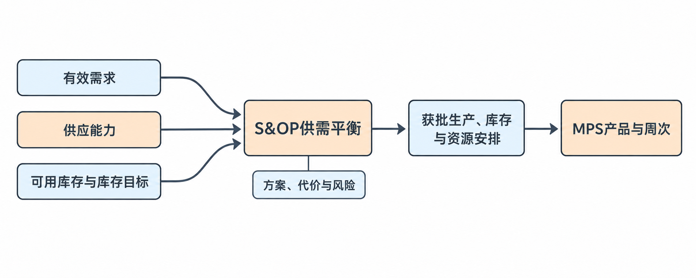
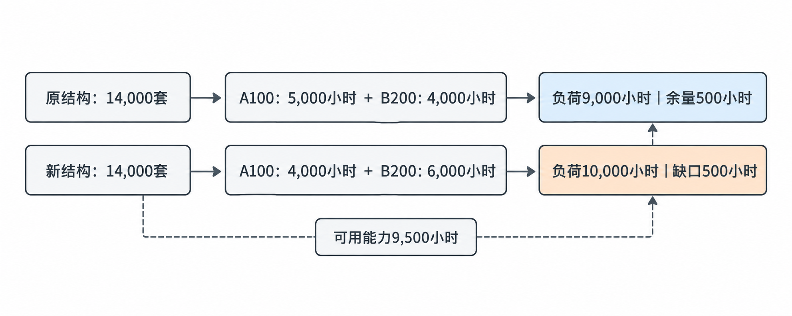
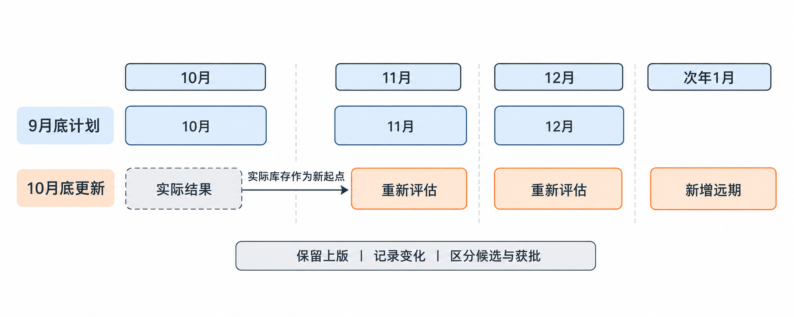
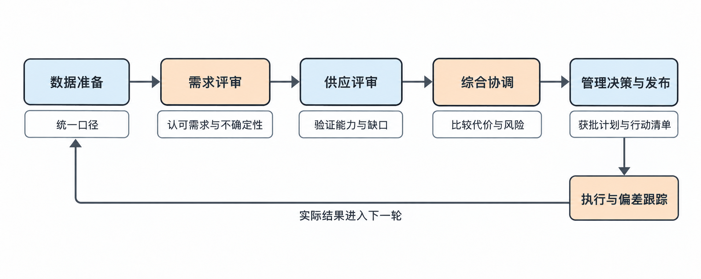
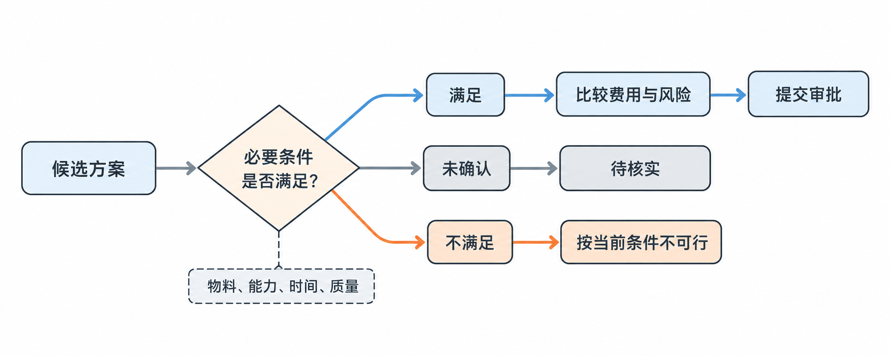
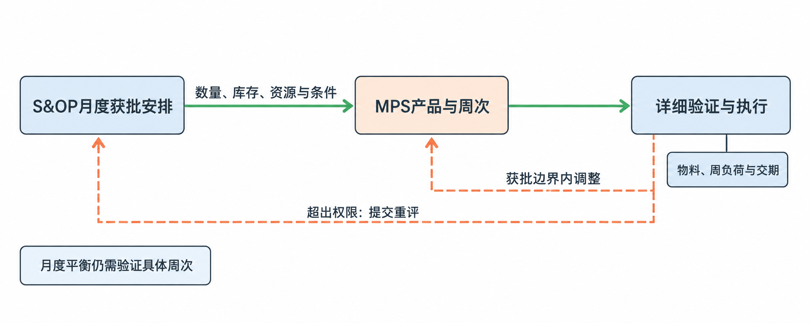

# 第四章 S&OP

销售与运营计划（Sales & Operations Planning, S&OP），也常称“产销协同计划”或“产销计划”。不同企业使用的名称、流程和管理颗粒度可能有所差异。

本章目标：解释S&OP在“需求 → S&OP → MPS → MRP”中的作用；根据需求、供应能力和库存识别未来几个月的供需缺口；比较提前生产、加班、外协和协商交期等方案的条件与代价；准备一份包含数据、风险和待决策事项的简化S&OP材料。

[TOC]

## 4.1 S&OP的作用与供需平衡

第三章已学习预测与订单抵扣、有效需求整理及需求变更后的交付评估，形成按产品和交付时间整理的有效需求，以及需求变化和风险记录。需求变化应比较两次有效需求，不能把历史预测直接替代上次有效需求；物料到厂时间与检验后可用时间应分别核对。

需求管理回答：“客户在什么时间，需要什么产品、多少数量？其中多少是正式订单，多少仍是预测？”需求明确后，工厂还需要回答：“准备以怎样的生产、采购和库存安排，支持未来这些需求？”

在教学背景中，客户接口人员收到未来三个月的需求。生产部门认为总装人员不足，采购部门指出关键连接器需要提前准备，财务部门希望控制库存占用。这些判断各有依据，但必须放到同一套计划中协调，否则可能出现：

- 客户接口按需求数量承诺交付，生产没有足够能力。
- 生产为了减少加班提前备货，客户随后降低预测。
- 财务要求压低库存，却未同时评估旺季交付需要多少提前备货。

S&OP形成一套跨部门认可的供需安排：生产多少、库存保持多少、资源如何准备，以及哪些风险需要管理层决策。输出进入主生产计划（Master Production Schedule, MPS），进一步分解为具体产品、具体周次的生产安排。

  

### 供需平衡框架与计划边界

| 要素 | 核心问题 | 主要输入 |
|---|---|---|
| 需求 | 未来需要交付多少？可信度如何？ | 有效需求、正式订单占比、需求变化 |
| 供应能力 | 未来能够完成多少？限制在哪里？ | 关键工序产能、人员、供应商供货能力 |
| 库存 | 能用多少库存承接波动？希望保留多少？ | 可用成品库存、库存目标、积压风险 |
| 成本与资源 | 为实现计划，需要付出什么代价？ | 加班、外协、加急、库存资金占用 |

> 需求计划表达“需要多少”；供应计划表达“准备怎样满足”。两者出现差距时，需要提出方案并作出决策。

例如，需求14,000套、正常月产能12,000套，不一定意味着2,000套无法交付，还要看期初可用成品、提前生产机会，以及物料和时间是否支持。反过来，车间名义上能生产14,000套，也不能证明供给足够；若连接器只支持12,000套，实际可实现的生产量仍受物料限制。

常见做法是按月开展S&OP，并滚动查看未来若干个月；计划展望期因业务模式、采购提前期和资源准备周期不同而有所差异。通常先在产品族或适合管理的汇总层级讨论供需，再向下分解；遇到关键产品、专用物料或瓶颈，需要展开查看。

| 环节 | 主要回答的问题 |
|---|---|
| 需求管理 | 客户需要什么、多少、何时交付？ |
| S&OP | 未来各月如何平衡需求、供应、库存和资源？ |
| MPS | 具体产品在哪一周安排生产多少？ |
| 物料需求计划（Material Requirements Planning, MRP） | 为支持生产，需要哪些物料、多少、何时到位？ |
| 生产排程 | 哪张工单在哪台设备、哪个班次执行？ |

S&OP可以决定“10月提前生产2,000套”，后续计划还须落实具体生产周次、物料和工序安排。月度总量平衡是制定详细计划的基础；具体订单是否按时交付，仍需要更细的时间与资源验证。

### 三个月供需与库存平衡推演

以下数量、产能和库存均为教学模拟数据，不代表真实企业情况。先只看WH-A100前门线束，假设：

- 10月初有可用成品库存2,000套，质量合格、版本匹配，且未分配给其他需求。
- 每月正常生产能力上限12,000套。
- 暂时假设物料能够支持计划生产量。
- 每月希望保留2,000套期末成品库存。
- 暂不考虑损耗、报废和其他库存调整。
- 为建立框架，先按月计算；月内交付先后顺序留给后续详细计划验证。

第三章整理出的有效需求如下：

| 月份 | 有效需求 | 正常生产能力上限 |
|---|---:|---:|
| 10月 | 10,000套 | 12,000套 |
| 11月 | 14,000套 | 12,000套 |
| 12月 | 12,000套 | 12,000套 |

本月开始时的库存，加上本月生产完成的数量，扣掉本月交付，剩下的就是本月期末库存，也成为下个月的期初库存。

**期末库存＝期初库存＋本月生产量－本月交付量。**

本案例把有效需求作为计划交付量使用；实际能否全部交付，需要供应安排支持。库存公式必须使用同一产品、同一数量单位和同一时间口径。

**方案一：每月尽量按当月需求生产，超过正常能力的部分由库存补充。**

| 月份 | 期初库存 | 计划生产 | 计划交付 | 期末库存 |
|---|---:|---:|---:|---:|
| 10月 | 2,000 | 10,000 | 10,000 | 2,000 |
| 11月 | 2,000 | 12,000 | 14,000 | 0 |
| 12月 | 0 | 12,000 | 12,000 | 0 |

11月期末库存＝2,000＋12,000－14,000＝0套。在这些假设下，月度数量能够支持交付，但11月和12月都没有保留目标库存，失去了原定的库存缓冲。

需要分别判断：

- 交付数量是否有缺口：按月汇总，当前没有。
- 是否满足库存目标：不满足，期末库存比目标少2,000套。

> 库存目标未达到与已经发生交付短缺是两个不同问题。期末库存为0不能直接解释成客户少收到2,000套。

**方案二：利用10月的空余能力提前生产。**

| 月份 | 期初库存 | 计划生产 | 计划交付 | 期末库存 |
|---|---:|---:|---:|---:|
| 10月 | 2,000 | 12,000 | 10,000 | 4,000 |
| 11月 | 4,000 | 12,000 | 14,000 | 2,000 |
| 12月 | 2,000 | 12,000 | 12,000 | 2,000 |

10月期末库存＝2,000＋12,000－10,000＝4,000套；11月期末库存＝4,000＋12,000－14,000＝2,000套；12月期末库存＝2,000＋12,000－12,000＝2,000套。

10月比当月需求多生产2,000套，把部分11月需求提前完成，既没有超过每月12,000套正常能力，也保留了后续月份的目标库存。当未来需求超过当期能力、前期存在空余能力时，可以评估通过提前生产、增加库存来承接需求高峰。

这个方案的代价与成立条件包括：

- 多出的2,000套提前占用资金和仓储空间。
- 11月需求下降或产品版本变化时，提前生产的成品可能积压。
- 相关物料必须在10月投产前可用，不能只看原定11月到货的供应量。
- 提前生产不能挤占其他产品已经需要的人员、设备和物料。

所以“10月有空余产能”只是一个条件，还需要需求、采购、生产和财务共同验证。库存可以缓冲需求波动，也可以缓冲生产故障、物料延期等供应波动，但持有库存同样承担需求下降和版本变化风险。

### 平衡结果与决策事项

| 项目 | 本案例应表达的内容 |
|---|---|
| 供需矛盾 | 11月需求14,000套，高于正常月能力12,000套 |
| 基础方案 | 用期初库存补足交付，但11月末库存降为0 |
| 候选方案 | 10月提前生产2,000套，11月末保留2,000套库存 |
| 成立条件 | 需求可信、版本稳定、物料提前可用、共享资源允许 |
| 主要代价 | 提前占用资金与仓储，承担需求下降和版本变化风险 |
| 待决策事项 | 是否批准提前生产及相应备料、库存安排 |

各参与者的作用：

- 客户接口或销售：确认需求来源、变化及客户接受条件。
- PMC：整合数据，计算平衡，提出缺口与候选方案。
- 生产：验证人员、设备和关键工序能力。
- 采购：验证供应商数量、交期及提前供货条件。
- 财务：评估库存资金和增量费用。
- 管理层：在跨部门取舍中批准方案、资源和风险承担。

如果使用企业资源计划系统（Enterprise Resource Planning, ERP），系统可以提供订单、库存、采购和生产数据。客户接口、采购、生产等人员维护各自数据，PMC汇总后用于S&OP分析；获批安排传递给MPS和后续采购、生产计划。系统中的数量和日期仍需核实，尤其要区分到厂与可用。

月度数量足够不能直接证明每笔订单按时交付。例如客户月初要货、生产到月末才完成，仍可能延期。S&OP批准总体安排后，具体日期承诺还需要核实：

- 物料何时完成检验并可用。
- 提前生产的2,000套安排在哪些周次，何时生产、检验完成。
- 成品是否匹配客户需要的版本，并分配给对应需求。
- 运输需要多久，能否赶上客户要求的收货日期。
- 产能是否足够，是否挤占其他产品已经需要的人员、设备和物料。

WH-A100与WH-B200不能仅因单位都是“套”，就认定消耗相同产能。仪表台线束可能需要更多总装工时，涉及共享资源时需要换成可比较的工时或其他统一口径。本小节只建立这一边界，具体汇总方法留给后续学习。

本节输入是有效需求、供应能力、可用库存与库存目标；处理是识别缺口、比较方案及代价、跨部门决策；输出是获批的生产、库存和资源安排及风险事项，再交给详细计划落实。完整判断链路为：**有效需求 → 核对供应与库存 → 找出缺口 → 比较方案及代价 → 跨部门决策 → 详细计划落实。**

## 4.2 计划层级与滚动机制

上一节建立了供需平衡框架。本节解决按什么层级看需求、向前看多远，以及每个月如何更新计划三个问题，输出一版具有统一口径、时间范围和版本的滚动计划，供后续供需评审及MPS使用。

### 产品汇总与资源负荷

工厂同时生产WH-A100前门线束和WH-B200仪表台线束。客户需求可以按“套”统计，但两种线束结构和加工复杂程度不同，一套产品消耗的资源不一定相同。

| 视角 | 解决什么问题 | 常用口径 |
|---|---|---|
| 产品或产品族需求 | 客户需要什么、多少？ | 产品编码、产品族、套数 |
| 关键资源负荷 | 这些需求需要多少资源？ | 总装工时、设备工时等 |

产品族（Product Family）通常把具有相近业务或生产特征的产品归为一组。不同企业可能按产品用途、工艺、客户或资源特点划分，并不存在唯一分类方式。汇总层级应服务于决策：讨论总装人员是否足够，应把共享总装资源的产品一起看；讨论专用连接器的供货风险，必须展开到使用该连接器的产品。

不能因为高层汇总表显示“线束总需求正常”，就忽略某个产品的专用物料缺口。

为突出产品结构影响，暂假设本月需要生产的数量等于本月需求，不考虑成品库存抵扣；WH-A100每套总装工时0.5小时，WH-B200每套总装工时1小时；总装本月可用能力9,500小时，已经按相同口径核算；暂不考虑其他工序和物料限制。

第一版需求如下：

| 产品 | 需求量 | 每套总装工时 | 所需总装工时 |
|---|---:|---:|---:|
| WH-A100 | 10,000套 | 0.5小时 | 5,000小时 |
| WH-B200 | 4,000套 | 1小时 | 4,000小时 |
| 合计 | 14,000套 | — | 9,000小时 |

**所需总装工时＝计划生产量×每套总装工时。**业务含义是完成这些产品总共需要占用多少总装加工时间。WH-A100需要10,000×0.5＝5,000小时，WH-B200需要4,000×1＝4,000小时，共9,000小时。可用能力9,500小时，因此尚有500小时余量。

客户随后调整产品结构：

| 产品 | 更新后需求量 | 每套总装工时 | 所需总装工时 |
|---|---:|---:|---:|
| WH-A100 | 8,000套 | 0.5小时 | 4,000小时 |
| WH-B200 | 6,000套 | 1小时 | 6,000小时 |
| 合计 | 14,000套 | — | 10,000小时 |

WH-A100需要8,000×0.5＝4,000小时，WH-B200需要6,000×1＝6,000小时，共10,000小时。总需求仍为14,000套，但总装工时从9,000增加到10,000小时，超过可用能力500小时。

原因是需求向总装工时更高的WH-B200转移。S&OP既要看总量变化，也要看产品结构变化；直接相加套数可能掩盖共享资源压力。

  

500小时缺口只说明总装能力不足，不能直接换成统一的“缺多少套”，因为具体缺哪种产品会影响对应数量。如何分配资源、安排加班或调整生产，需后续评估。

### 展望期、时间桶与更新频率

假设客户11月需要线束：总装加班可能较短时间就能安排；新员工招聘、培训和熟练度提升需要更长时间；专用连接器采购可能需要几个月；新增设备还可能涉及采购、安装和验证。如果只看下周，即使发现未来能力不足，也可能来不及准备资源。

**计划展望期（Planning Horizon）应覆盖重要供应和资源决策所需的时间。**常见做法是查看未来若干个月，有些企业看12个月或更长，具体长度取决于业务特点。本课程先用三个月建立逻辑，不能把三个月当成所有企业的固定标准。

| 时间概念 | 含义 | 教学示例 |
|---|---|---|
| 计划展望期 | 这一版计划向前看多远 | 查看未来12个月 |
| 时间桶（Time Bucket） | 每一列按什么时间单位汇总 | 按月汇总 |
| 更新频率 | 多久重新评审一次计划 | 每月更新一次 |

每月更新不意味着只看一个月；看未来12个月不意味着各月数据同样确定。近期通常有更多正式订单、采购承诺和已经投入的资源；远期通常有更多预测和待验证假设。因此计划应保留需求性质和可信度，不能把所有数量当成已确认订单。

### 滚动更新与版本管理

第三章的滚动预测更新需求；S&OP在更新需求后，继续重新评估供应、库存和资源。

| 计划版本 | 覆盖月份 |
|---|---|
| 9月底编制 | 10月、11月、12月 |
| 10月底更新 | 11月、12月、次年1月 |

  

**第一，把已经发生的10月替换为实际结果。**例如原计划10月末库存4,000套，实际可用库存只有3,500套，11月平衡计算应从实际可用库存3,500套出发，并解释500套差异，不能继续沿用原计划4,000套，好像偏差没有发生。

原计划4,000套仍应保留，用于比较实际与计划：实际－原计划＝3,500－4,000＝－500套。要查清原因，例如生产少完成、实际交付增加，或部分成品因质量问题暂不可用。不同原因对应不同后续措施。

实际与计划的比较属于执行偏差；同一月份在两版计划之间的比较属于计划版本变化。两者都支持决策，但回答的问题不同。

**第二，更新重叠月份的需求和供应条件。**重新核对11月、12月的有效需求、产品结构、供应商交期、人员与设备能力，以及原来批准的措施落实程度。比较需求变化时，应比较同一交付月份在两版计划中的有效需求，延续第三章口径。

**第三，加入一个新的远期月份。**加入次年1月，使展望窗口持续前移，提前发现新的供需风险。

滚动更新输出新版计划、相对上版的变化、未解决缺口，以及需要重新决策的事项。

新预测变化不能直接要求采购、生产全部跟着改。例如WH-B200需求增加后，应分别确认哪些采购尚未下单、哪些物料已订购且供应商已生产、哪些工单已投产、调整是否影响其他客户或产品，以及修改方案的额外费用。

新版需求是重新评估的输入；获批的新安排才是后续执行的依据。常见做法是对近期变更采用更严格的评估和审批，因为已有较多物料、工时和交付承诺投入。具体规则因企业而异，计划时界的细节留给后续学习。

系统或表格应保留上版获批计划、新版候选方案、变化原因和决策状态，使采购与生产分清评估中的调整和已批准执行的安排。

本节形成三项判断：

- 按决策需要选择产品和资源汇总口径；
- 按重要提前期选择展望范围并区分时间桶与更新频率；
- 按实际结果与最新条件滚动更新，同时保留版本和审批边界。

下一节在此基础上讲解如何组织跨部门评审并形成共同决策。

## 4.3 跨部门评审与决策闭环

上一节已经形成口径统一、带时间范围和版本的滚动计划。本节解决发现供需缺口后，各部门如何验证方案、作出取舍，并落实执行的问题。输出为获批的供需计划，以及明确责任人、完成期限和成立条件的行动清单，再进入MPS、采购和资源准备环节。

继续教学案例：WH-A100需求8,000套，每套总装0.5小时；WH-B200需求6,000套，每套总装1小时；总装负荷10,000小时，可用能力9,500小时，缺口500小时。PMC算出缺口后不能独自决定解决办法，因为各方案都依赖其他部门验证。

| 候选办法 | 必须确认什么 |
|---|---|
| 加班 | 人员能否到岗、设备是否可用、能增加多少有效工时 |
| 外协 | 外协方是否合格、能接多少、物料和运输是否支持 |
| 提前生产 | 前期是否有空余能力、物料能否提前可用、库存风险多大 |
| 调整交付 | 哪些需求可以调整、客户是否接受、有什么交付影响 |

算出缺口是识别问题；验证方案并批准资源，才形成可执行安排。S&OP让各部门基于同一版数据讨论，避免生产按旧需求准备、采购按另一版需求备料、客户接口又按最新预测承诺。

### 评审流程与部门职责

常见流程可理解为五步。不同企业的会议名称、次数和组织方式不同，小型工厂可能合并部分环节，但这些业务判断仍需完成。

| 环节 | 主要参与者 | 主要输入 | 应形成的输出 |
|---|---|---|---|
| 数据准备 | PMC及各数据负责人 | 最新需求、实际库存、供应和能力数据、上期执行结果 | 口径一致的评审数据 |
| 需求评审 | 客户接口、销售、PMC | 订单、预测、版本变化、客户信息 | 当前认可的需求计划及不确定性 |
| 供应评审 | 生产、采购、PMC，必要时质量等部门 | 需求计划、库存、物料和资源能力 | 可实现的供应量、缺口和候选方案 |
| 综合协调 | 相关部门及财务 | 候选方案、成本、风险、客户影响 | 推荐方案与尚未解决的分歧 |
| 管理决策与发布 | 有决策权限的管理者、相关负责人 | 推荐方案和待决策事项 | 获批计划、行动清单及未决事项 |

  

需求评审确认需求依据。例如WH-B200增加到6,000套，应说明来自正式订单、客户预测还是内部估计，并保留尚未确认的部分。认可一版需求计划，不意味着其中所有预测都变成订单。

供应评审确认在什么条件下能完成。“生产会努力完成”不能代替能力验证，要明确正常能力、可增加能力、物料条件以及对其他产品的影响。

综合协调把方案放在一起比较。生产希望减少加班、客户希望保持交期、财务希望控制费用，需要呈现各方案能解决多少缺口、有什么代价、哪些条件尚未确认。

管理决策明确批准内容，落实到数量、资源、费用或授权范围，明确负责人和期限。未解决事项保留状态，不能因会议结束就自动视为解决。

### 加班与外协的组合方案

继续同一案例，以下均为教学模拟条件：

- 本月需生产WH-A100共8,000套、WH-B200共6,000套，不考虑成品库存抵扣。
- 内部正常总装能力9,500小时。
- 生产核实本月最多可增加300小时有效加班能力。
- 一家已通过相应质量与工艺认可的外协方，可承担200套WH-B200，按内部标准工时折算可释放200小时总装负荷。
- 外协工序范围、运输和验收安排已验证。
- 暂假设全部物料可按内部和外协计划及时可用，其他工序也支持。

内部增加加班后的能力＝9,500＋300＝9,800小时。需求负荷10,000小时，只加班仍有10,000－9,800＝200小时缺口。

安排200套WH-B200外协，释放内部总装负荷＝200×1＝200小时。内部剩余负荷＝8,000×0.5＋5,800×1＝9,800小时。

| 项目 | 内部生产 | 外协生产 | 合计 |
|---|---:|---:|---:|
| WH-A100 | 8,000套 | 0套 | 8,000套 |
| WH-B200 | 5,800套 | 200套 | 6,000套 |
| 总装负荷，按内部标准折算 | 9,800小时 | 200小时 | 10,000小时 |

数量上可行的候选方案为：内部正常能力加300小时有效加班，配合200套WH-B200外协，支持全部需求。外协将部分加工任务转移出去，客户WH-B200需求仍为6,000套，没有减少。

必须分清资源归属：内部生产负荷9,800小时，内部可用能力也是9,800小时；外协支持200小时。外协减少内部任务，没有把内部能力增加到10,000小时。按相同口径汇总时，内部9,800小时能力加外协200小时支持可覆盖总需求10,000小时，但不能把汇总值写成内部能力。

假设财务核算：每增加一小时有效加班能力，增量费用60元；外协每套WH-B200相对内部生产的增量费用120元，已包含本例约定的运输和验收费用。

- 加班增量费用＝300×60＝18,000元。
- 外协增量费用＝200×120＝24,000元。
- 合计增量费用＝18,000＋24,000＝42,000元。

这里比较相对原安排多付出的费用，不是产品全部制造成本。42,000元不能自动证明方案应批准，还要判断交付重要性、替代方案、费用授权与执行风险。如果考虑调整交期，必须取得客户确认，不能直接修改需求让表格平衡。

### 决策发布与行动跟踪

管理层批准前，上述方案保持候选或推荐状态。批准后至少明确：

| 决策或行动 | 责任方 | 完成要求 |
|---|---|---|
| 批准300小时有效加班及相应费用 | 有权限的管理者、生产负责人 | 相关生产计划下达前落实 |
| 落实200套WH-B200外协 | 外协管理或采购负责人 | 确认订单、工序范围、数量及交期 |
| 按内部与外协安排配置物料 | PMC、采购及仓储 | 各自投产前保证物料可用 |
| 验证外协质量与验收安排 | 质量及相关部门 | 按计划完成检验，满足可交付条件 |
| 分解到具体产品和周次 | PMC | 形成后续MPS及执行安排 |
| 跟踪实际完成与偏差 | PMC及各执行负责人 | 异常发生时及时重新评估 |

实际记录还应填写具体日期；本例未给周次和客户收货日，因此只说明时间要求。行动完成应有证据：“外协已落实”应有确认的数量、工序和交期；“加班已落实”应有可兑现的人员与资源安排。

下一轮S&OP回看加班能力是否兑现、外协是否按期合格交付、费用是否偏离批准值、原缺口是否消除，形成决策与执行的闭环。

## 4.4 S&OP评审材料

上一节说明各部门如何验证方案并形成决策。本节解决PMC应准备哪些材料，才能让各部门看清问题、比较方案、明确批准事项。输出为简化S&OP评审材料；获批后，生产、外协、库存及资源安排进入MPS，风险与行动事项继续跟踪。

如果只提交“11月需求14,000套，总装缺500小时，建议加班和外协”，管理者仍无法判断需求总量还是产品结构发生变化、缺口如何计算、加班和外协各解决多少、物料和交期是否支持、增量费用多少，以及需要批准什么和哪些事项未确认。

简化材料应连起五件事：**需求变化 → 供需缺口 → 候选方案 → 成本与风险 → 待决策事项。**底层数据保留明细，评审先呈现影响决策的内容。关键数字应追溯到来源、版本和数据负责人。

| 口径项目 | 应说明什么 |
|---|---|
| 计划版本与数据截止时间 | 使用哪版需求，各项数据更新到何时 |
| 覆盖范围 | 哪些月份、产品或产品族、关键资源 |
| 数量与资源单位 | 套、件、小时等 |
| 库存口径 | 是否质量合格、版本匹配、未分配且可用 |
| 能力口径 | 正常能力与额外措施是否分开 |
| 重要假设 | 哪些条件只是暂时假设，尚未验证 |

同一个库存数量可能指账面库存，也可能指扣除冻结和分配后的可用库存；同一个能力可能仅含正常能力，也可能含尚未批准的加班。暂时假设不能在汇总中变成已确认事实。例如注明“暂假设物料支持”，结论就不能写“交付已确认”。

### 需求变化与供应能力

继续线束案例，补充以下教学模拟数据，订单与预测对应关系已核实：

| 产品 | 上版有效需求 | 本版正式订单 | 本版未转单预测 | 本版有效需求 | 变化 |
|---|---:|---:|---:|---:|---:|
| WH-A100 | 10,000 | 6,000 | 2,000 | 8,000 | −2,000 |
| WH-B200 | 4,000 | 5,000 | 1,000 | 6,000 | ＋2,000 |
| 合计 | 14,000 | 11,000 | 3,000 | 14,000 | 0 |

本版有效需求＝正式订单＋未转单预测。变化＝本版有效需求－上版有效需求。总有效需求没有增加，但向总装工时更高的WH-B200转移；14,000套中11,000套是正式订单，3,000套仍为预测。

不能把14,000套全部写成正式订单。预测仍需进入资源准备评估，不能因未转单而忽略。还应补充变化原因、客户是否确认当前版本，以及未转单预测的不确定性。

沿用WH-A100每套总装0.5小时、WH-B200每套1小时，假设本月生产量等于有效需求，不考虑成品库存抵扣。

| 项目 | 数值 | 状态或含义 |
|---|---:|---|
| 总装需求负荷 | 10,000小时 | 按本版产品结构计算 |
| 内部正常能力 | 9,500小时 | 已核实的基准能力 |
| 正常能力缺口 | 500小时 | 尚需解决 |
| 可增加的有效加班 | 300小时 | 生产已验证可行，待批准落实 |
| 外协候选量 | WH-B200 200套 | 加工能力已验证 |
| 外协释放内部负荷 | 200小时 | 按内部标准工时折算 |

如果方案获批并落实，内部生产负荷9,800小时，内部可用能力9,800小时，外协承担负荷200小时。内部能力不能写成10,000小时。材料还应说明物料、其他工序和运输是否支持，工时平衡只证明该资源维度在相应条件下能平衡。

### 方案、费用与成立条件

| 方案 | 对500小时缺口的作用 | 主要代价或问题 |
|---|---|---|
| 只使用正常能力 | 缺口仍为500小时 | 需明确受影响产品和交期 |
| 增加300小时加班 | 剩余缺口200小时 | 增量费用18,000元 |
| 加班300小时＋外协200套WH-B200 | 数量上解决500小时缺口 | 合计增量费用42,000元，仍需落实执行条件 |

只加班是部分解决方案，不能写成缺口全部消除。调整交期可以作为候选方向，但没有客户认可的数量和日期时，不能直接减少本月需求来让表格平衡。

有条件的推荐可以写为：“推荐增加300小时有效加班，并安排200套WH-B200外协，预计增量费用42,000元；执行需满足物料、质量、运输及审批条件。”这不等于已批准或已能承诺交付。42,000元包括加班18,000元和外协24,000元，不是外协单项费用。

### 风险记录与决策状态

本节撤销上一节“全部物料及时可用”的暂时假设，补充条件：内部生产所需物料已验证支持计划；外协200套WH-B200所需连接器检验后可用日期尚未确认；外协加工能力仍已确认。

| 字段 | 本案例内容 |
|---|---|
| 已知事实 | 外协200套所需连接器可用日期未确认 |
| 潜在影响 | 外协投产及这200套的交付可能延期 |
| 待核实内容 | 物料当前状态、检验放行日期、配送与加工时间 |
| 核实责任 | 采购或外协管理、质量、仓储物流 |
| 汇总与重评 | PMC核对时间链，更新可行交付安排 |
| 完成期限 | 外协投产安排锁定前落实；正式记录填写具体日期 |
| 当前状态 | 待核实，尚不能确认这200套按期交付 |

不能写“外协方没有连接器”或“连接器还未到位”，因为当前只知道可用日期未确认。物料可能未到、已到待检或正在检验，需要核实。

采购或外协管理核实物料状态与到货安排；质量首先确认连接器来料检验与放行时间，外协成品质量验证也需要，但不能替代来料节点；仓储物流确认配送时间；PMC汇总后，与外协方核实投产、加工、验收及运输安排，更新可行交付日期。

风险还应规定触发后的处理要求：核实结果若无法支持计划投产日，PMC应及时重评方案，把需要调整的资源、费用或交付事项提交对应决策人。

本案例至少有两类事项：资源与费用决策，即是否批准300小时加班、200套外协及42,000元增量费用；交付条件落实，即谁在什么日期前确认连接器可用时间，完成后续加工和运输验证。

即使资源与费用已经批准，物料条件仍可能待核实，不能用一个“已批准”状态掩盖交付风险。系统或表格保存需求、库存、能力和风险明细，由各数据负责人维护，PMC汇总为评审材料；决策发布后传给MPS及采购、生产执行，并保留版本、责任人和状态。

本节要求每个关键数字有口径、每个方案有条件、每个风险有责任、每项决策有明确内容。材料审核时应准确区分数量性质、资源归属和事实状态，再形成判断。下一节进一步比较供需调整方案及其代价。

## 4.5 供需调整方案与取舍

上一节已把需求变化、供需缺口、候选方案和风险整理成评审材料。本节解决多个方案看起来都能解决缺口时如何比较、为什么推荐某个方案。输出为有依据的推荐方案、成立条件和备用安排，供管理决策，再传给MPS及采购、生产执行。

### 约束识别与方案评价

| 缺口类型 | 具体问题 | 可以评估的方向 |
|---|---|---|
| 加工能力不足 | 物料有，但人员或设备无法按期完成 | 加班、提前生产、外协、扩充资源 |
| 物料不足 | 加工能力有，但关键物料不可用 | 提前供货、调配、经批准的替代料 |
| 时间不匹配 | 月度总量足够，但赶不上具体日期 | 提前安排、分批交付、调整运输或交期 |
| 产品结构不匹配 | 有库存或能力，但不适用于所需产品 | 核对版本、工艺、专用物料及资源适配 |

WH-B200缺连接器时，单纯增加总装加班不能解决问题；总装缺工时时，连接器提前到厂也不能自动增加能力。措施必须作用于真正限制交付的条件，多个限制存在时应一起验证，不能解决一个就宣布交付可行。

比较顺序为：**能否实现 → 能解决多少 → 有什么代价 → 剩余风险是什么 → 条件变化后怎样调整。**先验证物料、能力、时间和质量等必要条件，未通过条件的方案即使费用低，也不能视为可执行。

  

可行性验证后，比较加班、外协、加急等增量费用，提前生产的资金与仓储占用，对其他产品和客户的影响，对需求下降、版本变化和供应延期的承受能力，以及执行后是否还能改量、取消或转作其他用途。常见做法是综合比较，但不同企业因交付要求、资源条件和管理权限不同而有所差异，没有措施永远最优。

### 加班、外协与提前生产的比较

以下均为教学模拟数据：WH-A100有效需求8,000套，每套总装0.5小时；WH-B200有效需求6,000套，每套总装1小时；合计14,000套，其中正式订单11,000套、未转单预测3,000套。11月内部正常能力9,500小时。不采取措施时总装负荷10,000小时，缺口500小时。

**方案A：11月加班300小时，外协200套WH-B200。**

| 项目 | 数值 |
|---|---:|
| 内部生产负荷 | 9,800小时 |
| 内部正常能力＋加班 | 9,800小时 |
| 外协承担负荷 | 200小时 |
| 加班增量费用 | 18,000元 |
| 外协增量费用 | 24,000元 |
| 合计增量费用 | 42,000元 |

该方案在能力数量上平衡，但外协200套连接器可用日期仍需确认。

**方案B：10月提前生产500套WH-B200，11月使用正常能力。**本节新增条件：生产核实10月保护其他已承诺任务后，确有500小时空余总装能力，暂假设其他工序支持。

提前完成500套WH-B200需要500×1＝500小时。若10月底这500套成为合格、版本匹配且供11月使用的成品，11月还需生产WH-A100共8,000套、WH-B200共6,000－500＝5,500套。

11月内部负荷＝8,000×0.5＋5,500×1＝9,500小时，匹配正常能力，不需要方案A的加班和外协。WH-B200需求仍为6,000套，其中500套由期初成品支持、5,500套由当月生产支持，需求没有减少。

假设提前生产的增量库存持有费用每套8元，并已核实没有其他增量费用，则500×8＝4,000元。

| 比较项 | 方案A：加班＋外协 | 方案B：提前生产 |
|---|---|---|
| 解决方式 | 增加当期内部能力，转移部分加工任务 | 把部分加工任务移到前月 |
| 11月内部负荷 | 9,800小时 | 9,500小时 |
| 11月内部能力 | 含加班9,800小时 | 正常9,500小时 |
| 本例增量费用 | 42,000元 | 4,000元 |
| 关键条件 | 加班落实、外协物料与交期支持 | 前月资源、物料与完工时间支持 |
| 主要风险 | 外协交付、质量与执行协调 | 提前库存占用、需求及版本变化 |

初步只能判断方案B在所给费用口径下更便宜，仍须验证提前生产条件。提前生产降低11月负荷，没有把11月正常能力增加到10,000小时；10,000小时是未使用提前成品时的加工负荷。

### 可行性验证与后续调整

继续调查发现：完成方案B必须在10月20日前取得相关连接器并启动生产；该批连接器最早10月25日检验完成并可用；暂无其他经核实可用来源。

10月虽有500小时空余能力，物料却不能支持所需启动时间。因此方案B按当前条件不可行，4,000元的费用优势不能弥补时间缺口。可继续调查提前供货或其他合规来源，但落实前不能写成可执行计划。

方案A仍为候选，需要确认外协物料和交付时间。后续条件核实支持计划，再完成资源与费用审批，才能落实。如果两个方案均未通过验证，应提交未解决缺口，评估其他办法或与客户协商，不能为选出方案而默认未知条件满足。

这里应区分：已知必要条件不满足，标“按当前条件不可行”；信息尚未落实，标“待核实”。方案B的目标是10月底形成供11月交付使用的可用成品，不是半成品，也不是要求10月交给客户。

加班和外协可以缓解短期压力，但若未来连续多月都缺500小时，仅靠每月临时协调可能产生持续费用与执行风险，需要评估招聘培训、增加工位、长期外协或设备投入。

新员工需要招聘、培训和熟练度提升；新设备需要安装、验证并形成有效能力；长期外协需要质量、供应和管理条件支持。可组合近期已验证的临时措施与中期新增能力准备。资源获批不等于能力立即可用，应按实际可兑现月份计入计划。

WH-B200未转单预测减少时，不能立刻认定提前生产的500套全部成为呆滞库存。应核对当前正式订单、有效需求和后续需求；成品能否用于这些需求且版本匹配；未生产计划能否减少；采购、外协及工单承诺或执行程度；调整费用和对其他需求的影响。

延续第三章逻辑：需求变化触发重评，处理办法取决于需求与供应两侧实际状态。

推荐方案最终说明解决哪个缺口、解决多少、为什么可行、增量代价、剩余风险及条件失效后的应对。下一节衔接获批S&OP向MPS的传递与详细验证。

## 4.6 S&OP与MPS的衔接

本节解决总体方案获批后，PMC如何传给详细计划，以及详细验证发现问题后如何反馈。输出为明确的计划输入、约束条件和反馈事项，衔接第五章MPS。

假设管理层批准10月提前生产500套WH-B200、11月使用正常能力完成剩余生产，执行人员仍需知道提前完成的500套是否成为可用成品、11月各产品还需生产多少、客户具体收货日期、哪些周次具备物料和能力，以及详细计划无法实现时由谁重评。

S&OP输出应传递数量、时间、资源、库存和决策条件，不能只有会议结论。

| 传递内容 | 对下游计划的作用 |
|---|---|
| 当前有效需求及订单、预测性质 | 确认需求对象和确定程度 |
| 获批的月度生产、外协安排 | 明确总体供应方向 |
| 期初可用库存及期末库存目标 | 确定哪些需求由库存支持，需保留多少缓冲 |
| 正常能力和额外资源安排 | 给出实际可用资源边界 |
| 关键物料及可用日期 | 限定最早可生产时间 |
| 未解决风险、成立条件和责任人 | 防止假设变成事实，持续跟踪条件 |

MPS接收输入，进一步安排具体产品在具体周次生产多少，并验证是否支持交付。

  

### 需求、生产量、负荷与能力

本节采用新的教学模拟条件：方案B物料问题已经解决，10月底确实形成500套合格、版本匹配、供11月使用的WH-B200成品，方案已经获批。这是条件改变后的推演，不是将上一节按原条件不可行的方案直接视为获批。

| 项目 | WH-A100 | WH-B200 |
|---|---:|---:|
| 有效需求 | 8,000套 | 6,000套 |
| 可用于本月需求的期初成品 | 0套 | 500套 |
| 本月计划生产 | 8,000套 | 5,500套 |
| 每套总装工时 | 0.5小时 | 1小时 |

暂不考虑期末库存目标、损耗和其他调整。

- 需求量：客户需要多少，合计14,000套。
- 生产量：本月需要加工多少，合计13,500套。
- 生产负荷：加工这些产品需要多少资源。
- 可用能力：人员、设备等本月能够提供多少有效加工时间。

本月负荷＝8,000×0.5＋5,500×1＝9,500小时。内部正常能力仍为9,500小时。库存支持部分需求，降低本月生产量和负荷，没有增加内部能力。

### 从月度平衡到周次验证

为教学将11月简化成四个计划周，不代表实际日历周划分。每周WH-A100需求2,000套、WH-B200需求1,500套；每周内部总装能力2,375小时，四周合计9,500小时；暂假设物料、其他工序、运输支持，生产完成时间能满足对应需求。

先尝试用500套期初成品支持第一周：

| 计划周 | A100生产量 | B200生产量 | 总装负荷 | 可用能力 |
|---|---:|---:|---:|---:|
| 第1周 | 2,000 | 1,000 | 2,000小时 | 2,375小时 |
| 第2周 | 2,000 | 1,500 | 2,500小时 | 2,375小时 |
| 第3周 | 2,000 | 1,500 | 2,500小时 | 2,375小时 |
| 第4周 | 2,000 | 1,500 | 2,500小时 | 2,375小时 |
| 合计 | 8,000 | 5,500 | 9,500小时 | 9,500小时 |

第一周负荷＝2,000×0.5＋1,000×1＝2,000小时，余量375小时；后三周每周负荷＝2,000×0.5＋1,500×1＝2,500小时，各超125小时。月度合计相等，仍有具体周次超负荷。

第一周空余能力不会自动转移到第三周，可转移的是生产任务，前提是提前加工可行。详细计划需评估把部分后续任务提前，同时核对物料可用时间、库存与客户需求。

### 计划调整与执行反馈

先判断是否能在原获批安排内解决。物料及时可用、提前加工不影响其他任务，且没有超出获批库存和资源边界时，按企业规定调整详细计划并保留记录。

若必须增加加班费用、增加外协、显著改变库存安排或调整客户交期，应提交对应权限重新评估。反馈应说明哪个产品、哪个周次、缺多少资源、原因、候选方案、各方案影响和待批准事项，不能只写计划排不出来，更不能擅自把正常能力9,500小时改成10,000小时让表格平衡。

紧急交付风险应及时升级处理，不必等待下次月度会议；长期供需影响纳入后续S&OP更新。

成品数量平衡的基本关系是：期初可用成品＋本期生产＋其他成品供应－本期交付＝期末库存。先据此确定生产量，再按单位工时换算负荷，最后与同一时间范围内的能力比较。降低期末库存目标会降低生产量与负荷，但不会增加正常能力；库存目标也是计划约束，调整前需确认权限和后续交付风险。

周次判断除比较负荷与能力外，还需核对期初成品能否覆盖当周交付、物料是否能在投产前完成检验放行、客户具体交付日期，以及提前生产所需的前期空余能力和完成时间。后续周次的空余能力不能自动补救已经到期的交付。月度检查通过后仍须检查周次，周次检查通过后仍须核对具体日期。

资源缺口应在周计划批准和执行前识别并反馈；执行中出现新偏差时应立即反馈。若必须新增未获批的加班费用，PMC应量化缺口、加班增量能力、费用、物料支持条件及交付影响，提交有权限的人批准。批准且人员、设备等资源落实后，才能据此更新计划；“已反馈”“正在协调”“已批准”和“能力已落实”是不同状态。

PMC跟踪实际生产完成量、物料可用情况、加班及外协兑现情况、库存水平和客户需求交付变化，作为下一轮计划起点与偏差原因。

计划10月底完成500套成品、实际仅400套可用时，应重评11月剩余生产量及新增负荷，不能继续使用计划500套作为实际库存。

ERP提供需求、库存和生产等记录，PMC结合相关部门核实的数据组织计划。获批S&OP约束向MPS传递，详细验证和执行偏差向上反馈，系统计算依赖正确的数据口径和状态维护。

> S&OP确定总体取舍 → MPS落实产品与周次 → 详细验证发现约束 → 按权限调整或反馈 → 执行结果进入下一轮S&OP。
