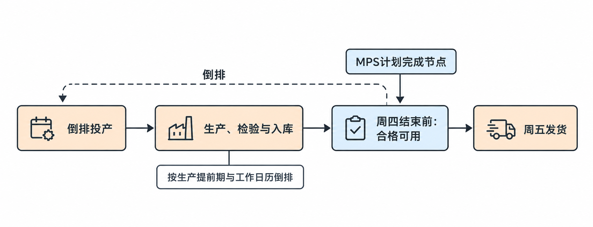
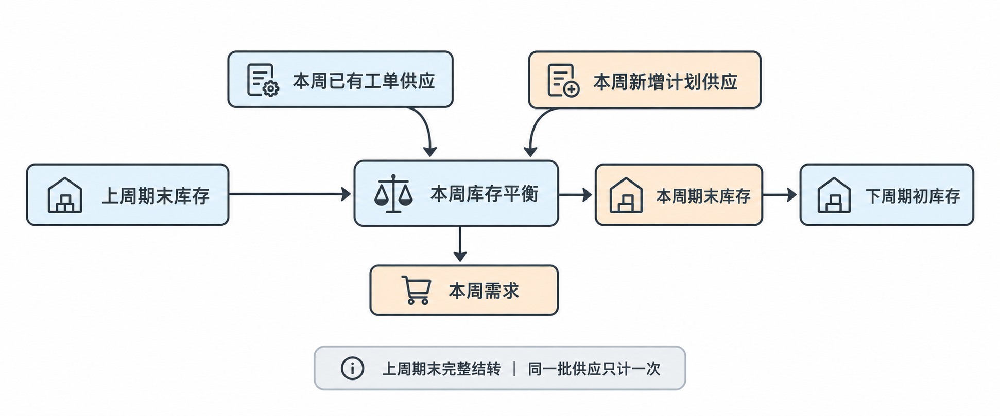
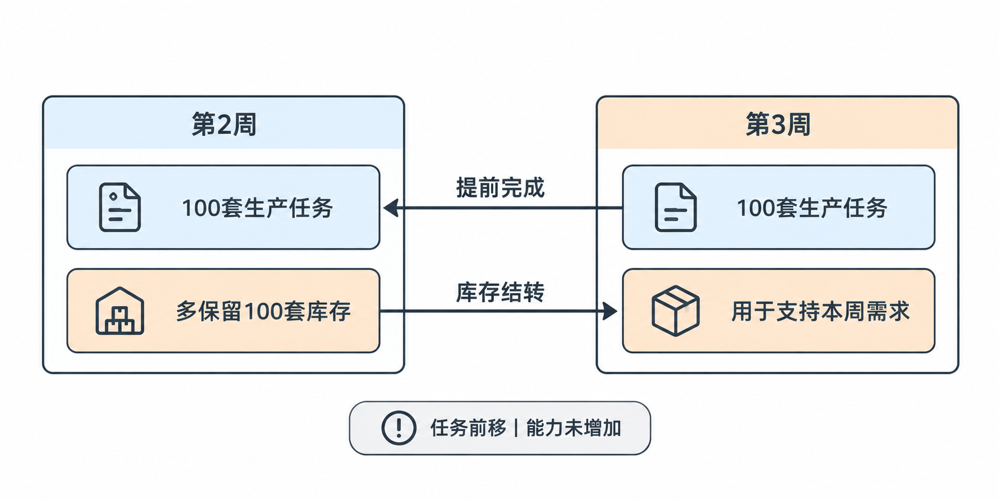
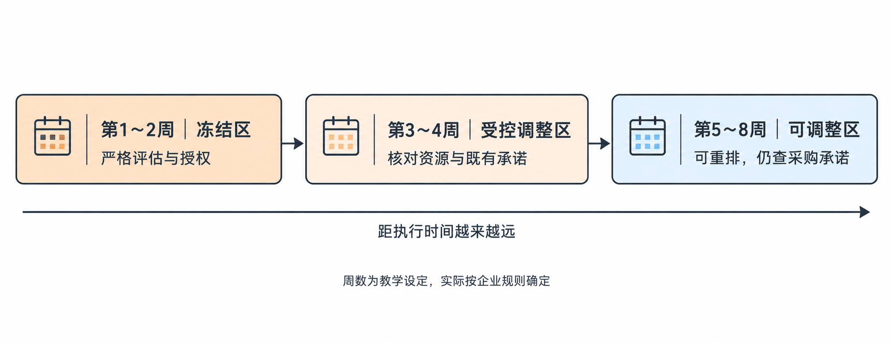
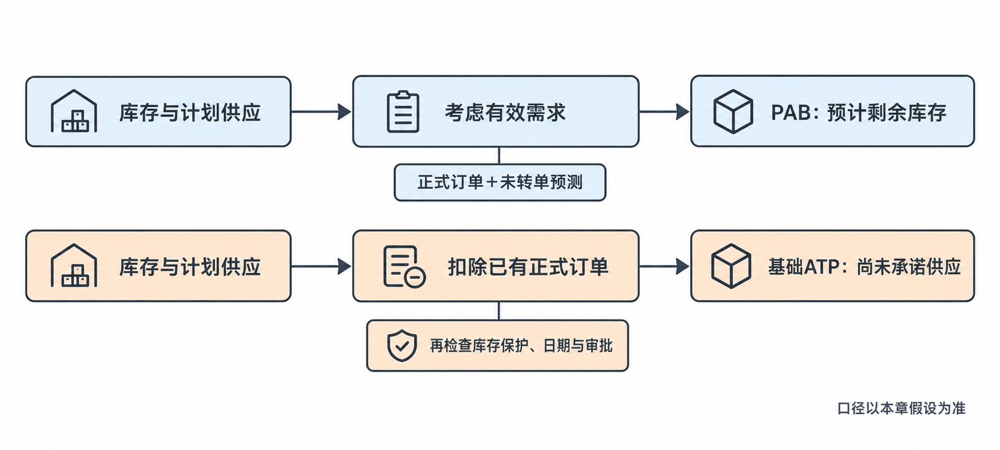

# 第五章 主生产计划（MPS）

[TOC]

本章学习如何按周安排成品数量与完成时间、计算预计库存、控制计划变更，以及用ATP判断新增订单。各例使用当节列明的数据，学完本章后再集中完成综合练习。已有题目与作答保留在[案例与练习](02-案例与练习.md)中。

## 5.1 主生产计划的作用

上一章S&OP已经形成月度需求、生产安排、库存目标和批准资源。本节解决如何把月度安排落实为具体产品在具体时间完成多少套，输出为按周表达的成品供应计划，后续用于计算物料需求，并进一步形成生产执行安排。

### MPS安排什么

假设S&OP已经批准线束工厂本月生产4,000套WH-A100前门线束。这还不足以指导执行：客户可能第三周需要1,200套，如果大量产品集中到第四周完成，即使月底生产总量达到4,000套，第三周仍可能交付不足。

**主生产计划（Master Production Schedule, MPS）**对选定计划对象的生产数量和完成时间作出安排。本课程先以成品型号为计划对象，采用周级时间段，至少回答三个问题：

- 生产什么：具体产品型号及必要的版本。
- 生产多少：各时间段需要形成的合格供应数量。
- 何时完成：产品应在哪个时间段成为可用成品。

本节MPS表中的数量表示计划完成检验放行、能够用于交付的成品数量。投产日期需要结合生产提前期另行倒排，不能把“本周计划完成1,000套”理解成“本周才开始生产1,000套”。

常见做法是对成品或关键装配件编制MPS，但不同企业会因为生产模式和产品结构不同而选择不同的计划对象与时间粒度，并非所有企业都按成品、按周管理。

MPS不是把客户需求直接复制成生产计划。客户需要的产品，一部分可能已经在库，一部分可能由已下达工单提供，还可能需要保留库存缓冲。

| 输入 | 要解决的问题 |
|---|---|
| 分产品、分时间的有效需求 | 什么产品在什么时候需要多少？ |
| 期初可用成品 | 已有多少需求可以由库存支持？ |
| 已有工单及预计完工时间 | 已经安排的供应能提供多少、何时提供？ |
| 库存目标与批量规则 | 除满足需求外，还需保留多少、如何组织批量？ |
| 获批S&OP安排 | 已批准的月度生产量、资源和费用分别是多少？ |
| 关键物料、关键资源与提前期 | 拟定完成数量和日期是否有条件实现？ |

有效需求沿用第三章已经建立的口径，保留正式订单和未转单预测的性质，不把两者重复相加。

已有工单容易重复计算：某周计划完工总量中若已有工单提供部分供应，新增安排只需补足剩余部分。同一批成品不能既算已有供应，又完整算进新增供应。已有工单也需核实是否能够按时形成合格可用成品，不能只凭订单状态默认供应已经实现。

| 环节 | 主要回答的问题 |
|---|---|
| S&OP | 总体供需如何平衡，采用哪些资源和库存方案？ |
| MPS | 具体产品在哪个时间段完成多少？ |
| 物料需求计划（Material Requirements Planning, MRP） | 为支持这些产品，需要哪些物料、多少数量、何时到位？ |
| 工单与车间排程 | 具体任务如何下达，安排到哪些日期、设备和班组？ |

一行“WH-A100第三周完成1,100套”，还没有说明连接器采购多少，也没有说明星期几在哪个总装工位加工。

编出MPS表后，还需要验证关键资源和物料条件。若必须增加原来未批准的资源或费用，应提交重新评估；具体能力检查方法在后续章节展开。

### 四周成品计划

以下为BYD线束工厂的教学模拟数据，只看WH-A100，不代表真实企业政策或经营数据。

- 期初可用成品200套，无其他成品供应。
- 四周有效需求分别为800、1,000、1,200、1,000套，均在对应周周五发货。
- 月末库存目标200套，各周期末库存不得低于100套。
- 计划完工数量均须在对应周周四结束前完成检验放行并入库。
- 每套总装需要0.5小时，每周可用总装能力550小时。
- 暂假设物料和其他工序支持该安排；运输另按客户到货要求安排。

  

先看月度：本月需生产＝4,000套需求＋200套期末目标－200套期初库存＝4,000套。

不能就此每周平均安排1,000套，还要按需求发生时间检查库存。下面是一版候选安排：

| 项目 | 第1周 | 第2周 | 第3周 | 第4周 |
|---|---:|---:|---:|---:|
| 有效需求／计划发货量（套） | 800 | 1,000 | 1,200 | 1,000 |
| 计划完工可用量（套） | 800 | 1,000 | 1,100 | 1,100 |
| 预计期末库存（套） | 200 | 200 | 100 | 200 |
| 总装负荷（小时） | 400 | 500 | 550 | 550 |
| 可用总装能力（小时） | 550 | 550 | 550 | 550 |

**本周期末库存＝上周期末库存＋本周完工可用量－本周需求。**

- 第一周：200＋800－800＝200套。
- 第二周：200＋1,000－1,000＝200套。
- 第三周：200＋1,100－1,200＝100套。
- 第四周：100＋1,100－1,000＝200套。

第三周需求1,200套，但本周只生产1,100套，因为用到了之前保留的100套库存。第四周再恢复到月末目标200套。

这版安排的四周生产合计4,000套，与月度安排一致；各周库存没有低于100套，月末达到200套目标；各周总装负荷没有超过550小时能力；按已给定的假设，成品可用时间早于当周发货时间。

它是一版满足当前条件的方案，未必是唯一方案。实际还可能受换型、批量、产品版本和其他产品共享资源影响。

### 计划调整与系统应用

如果第三周部分产品延期到第四周，月度完工总量可能不变，但第三周可用供应已经减少。PMC应重新检查受影响周次的库存、交付和资源，不能只看月底总数。若连接器只是已到厂、尚未检验放行，也不能直接假设原完工计划成立。

MPS需要同时表达数量与时间，库存把不同周次的需求和供应连接起来。逐周计算发现的负余额是供应不足的计划信号，不是允许仓库实际发出负库存；还要区分库存缓冲不足与客户交付不足。延期到后续周次的任务会占用后续能力，即使最终补齐数量，也不能据此认定原交期已满足。

在企业资源计划（Enterprise Resource Planning, ERP）系统中，主计划员或PMC读取上游需求管理、库存和已有工单数据，形成并维护MPS；下游MRP据此展开物料需求，生产管理据此细化执行任务。系统能辅助计算，但仍依赖正确的数量、日期、版本及供应状态。

MPS依据需求、库存、已有供应和获批资源安排产品数量与完成时间，并保留尚未解决的风险。S&OP确定总体生产与资源安排，MPS落实具体产品和完成日期，MRP再据此计算物料数量及用料时间。

## 5.2 周级MPS的编制与库存衔接

上一节已经明确MPS安排具体产品的数量与完成时间。本节解决这些数量怎样逐周算出来，以及计算结果超出能力时怎样调整。本节接收分周需求、期初库存、已有工单和库存要求，形成“已有供应＋新增计划＋预计库存”的周计划，再检查物料和能力是否支持。

### 库存与供应计算

| 数量 | 含义 |
|---|---|
| 期初可用库存 | 现在已经存在、可以使用的合格成品 |
| 已有供应 | 已下达工单预计在未来某周完成的合格成品 |
| 新增计划完工量 | 为补足需求和库存要求，还需要新增安排的供应 |

期初库存只能在第一周作为起点使用。第二周开始，要承接上一周算出的期末库存，不能每周重新使用一次最初的库存。上周期末库存应完整结转为本周期初库存，其中已经包含提前生产形成的数量，不能再额外加一次。

已有工单虽然尚未完工，也可以作为计划中的未来供应，但必须按预计可用时间计入对应周，持续跟踪兑现情况。

本节把已有供应与新增计划分列，因此本周总计划完工量＝本周已有供应＋本周新增计划完工量。这是本节表格的统计口径，避免重复计算。

预计可用余额（Projected Available Balance, PAB，也常称预计可用库存）表示考虑计划中的需求与供应后，某个时间段预计还能剩多少。本节按周期末计算：

> 本周期末预计库存＝上周期末预计库存＋本周已有供应＋本周新增计划完工量－本周需求。

  

编制计划时，可以先暂时不加新增生产，看看已有资源够不够：

> 未新增生产前的余额＝上周期末预计库存＋本周已有供应－本周需求。

再与本周期末库存要求比较。若不足，就补足差额：

> 新增计划完工量＝max〔0，本周期末库存要求－未新增生产前的余额〕。

这里max表示两项取较大值，即不让新增计划量变为负数。业务含义是先使用已有库存和已有供应，再补上满足需求及库存要求所缺的部分。若已有供应已经足够，新增计划为0，但已有供应过剩是否需要调整，还须另外评估。

这只是数量上的初算。本节暂不考虑批量限制，允许按所需数量安排；实际有最小生产批量或批量倍数时，还需要调整，并重新计算库存。

### 逐周编制与产能检查

本例独立编制一份WH-A100四周计划，全部数据为教学模拟：

- 期初可用成品200套。
- 四周需求分别为800、1,000、1,200、1,000套，均在对应周周五发货。
- 前三周期末库存至少100套，第四周期末目标200套。
- 每套总装0.5小时，每周可用能力550小时。
- 成品须在对应周周四结束前完成检验放行并入库。

第二周已有工单将提供300套合格成品；其他周没有已有供应，新增生产计划单独计算。暂不考虑批量限制，物料和其他工序按时支持。

第一周：未新增前余额＝200＋0－800＝－600套。为交付后还剩100套，新增计划＝100－（－600）＝700套。期末库存＝200＋700－800＝100套。

第二周承接第一周剩下的100套，并使用已有工单300套：未新增前余额＝100＋300－1,000＝－600套。新增计划＝100－（－600）＝700套。期末库存＝100＋300＋700－1,000＝100套。

第三周：未新增前余额＝100＋0－1,200＝－1,100套。新增计划＝100－（－1,100）＝1,200套。期末库存＝100＋1,200－1,200＝100套。

第四周：未新增前余额＝100＋0－1,000＝－900套。月末目标为200套，因此新增计划＝200－（－900）＝1,100套。期末库存＝100＋1,100－1,000＝200套。

| 项目（套） | 第1周 | 第2周 | 第3周 | 第4周 |
|---|---:|---:|---:|---:|
| 期初预计库存 | 200 | 100 | 100 | 100 |
| 有效需求 | 800 | 1,000 | 1,200 | 1,000 |
| 已有工单供应 | 0 | 300 | 0 | 0 |
| 期末库存要求 | 100 | 100 | 100 | 200 |
| 新增计划完工量 | 700 | 700 | 1,200 | 1,100 |
| 总计划完工量 | 700 | 1,000 | 1,200 | 1,100 |
| 期末预计库存 | 100 | 100 | 100 | 200 |

第二周新增安排700套，但总完工为1,000套。已有工单也占用生产资源，检查本例总装负荷时不能只算新增计划。

按总计划完工量换算总装负荷：

| 项目 | 第1周 | 第2周 | 第3周 | 第4周 |
|---|---:|---:|---:|---:|
| 总计划完工量（套） | 700 | 1,000 | 1,200 | 1,100 |
| 总装负荷（小时） | 350 | 500 | 600 | 550 |
| 可用能力（小时） | 550 | 550 | 550 | 550 |

第三周超出能力50小时，对应50÷0.5＝100套。所以虽然库存计算没有缺口，第三周仍无法按当前能力完成计划。

一种处理办法是把第三周的100套提前到第二周完成。第二周正好还有50小时余量，但必须先确认物料、其他工序、完成时间和批准范围支持提前生产。

确认这些条件成立后，调整为：

| 项目 | 第1周 | 第2周 | 第3周 | 第4周 |
|---|---:|---:|---:|---:|
| 已有工单供应（套） | 0 | 300 | 0 | 0 |
| 新增计划完工量（套） | 700 | 800 | 1,100 | 1,100 |
| 总计划完工量（套） | 700 | 1,100 | 1,100 | 1,100 |
| 期末预计库存（套） | 100 | 200 | 100 | 200 |
| 总装负荷（小时） | 350 | 550 | 550 | 550 |

第二周：100＋300＋800－1,000＝200套。第三周：200＋1,100－1,200＝100套。

提前生产使第二周期末多保留100套库存，再用这100套支持第三周需求。

> 提前生产改变任务所在周次，没有增加第三周能力。

  

四周总完工仍为4,000套，其中已有工单300套、新增计划3,700套。这个月度总量必须与库存平衡和获批安排核对。本例的期初库存、已有工单和新增计划均按本节数据计算，不叠加其他例子的供应。

本例按完工数量乘单位总装工时，将对应总装负荷简化放在完工周，用于教学性检查；若实际加工跨周，真实资源负荷须按工艺、投产日期及各工序发生时间分配，不能机械全部放在完工周。

### 完工日期与计划更新

表中安排第三周完成1,100套，下一步还需要结合生产提前期，检查最迟何时投产、物料何时必须可用。

例如，若某批产品需要完整的5个工作日才能完成生产、检验和入库，就不能等到要求完成的周四才投产。应按工作日历倒排，并明确提前期是否包含检验和入库。

已有工单如果延期，应修改它的预计可用日期，再重算受影响周次。不能继续把延期供应留在原周，让表格保持平衡。

需求可以满足但交付后的预计库存低于要求时，属于库存目标缺口；供应不足以满足当期需求时，属于交付缺口。有明确日期条件时应给出明确判断，而不只写“不一定缺交”。即使当周交付未受影响，缓冲库存耗尽和后续周次超能力仍需处理。

在ERP中，PMC或主计划员使用需求、库存、已有工单及计划参数计算候选计划；确认约束后维护计划，向MRP传递新增生产需求，向生产管理传递执行安排。同一批已有工单供应必须保持一致的归属，不能再次变成一笔新增任务。

这份周计划同时检查了库存结转和总装能力。需求或供应变化后，还需核对哪些任务已经下达、哪些资源已经承诺，再决定如何修改。

## 5.3 时间围栏与计划变更控制

上一节已经形成一版经过库存和关键能力检查的周计划。本节解决需求变化后计划允许怎样修改。输入为当前MPS、变化后的需求、已下达任务及资源承诺，输出为变更影响、处理方案和审批结果。批准后的计划传给MRP、采购与生产执行，避免各部门按不同版本行动。

### 时间围栏与计划状态

WH-A100第二周增加200套需求时，重新计算数量并不困难。但原计划可能已经推动采购下单、供应商生产连接器、仓库按工单备料、车间安排人员工位和加工顺序；其他产品占用了剩余能力，客户也已得到交付承诺。

修改MPS会影响这些安排。尤其临近执行时，插单可能导致换型、加班、物料加急以及其他订单延期。因此，PMC既要判断新方案能否满足需求，也要判断哪些安排已经形成承诺、改变会影响谁、付出什么代价、由谁批准。

时间围栏（Time Fence，也常称计划时界或时间栅栏）把未来计划划分为不同时间段，分别规定变更要求。本教学案例采用以下管理规则：

| 区域 | 范围 | 变更原则 |
|---|---|---|
| 冻结区 | 第1～2周 | 保护已形成的执行安排，变更需严格评估和授权 |
| 受控调整区 | 第3～4周 | 可以调整，但需核对物料、能力、库存及已形成的承诺 |
| 可调整区 | 第5～8周 | 可以较充分地根据新需求重排，仍需检查长期资源和采购承诺 |

这些周数只是教学设定。常见做法是结合生产提前期、采购提前期、产品特点及客户要求确定各区域的长度，不同企业会有所差异。

  

冻结区不是绝对不能改变。设备故障、质量问题或关键客户紧急需求出现时，可能必须调整，区别在于需要走例外评估与批准。可调整区也不是随意修改：第六周成品尚未投产，但长交期连接器可能早已采购，取消生产仍可能留下材料和费用。

这些区域随滚动计划向前移动，但已经形成的工单、采购订单和客户承诺，不会因为时间分段移动就自动消失。

需求时界（Demand Time Fence, DTF）主要控制近端需求采用什么口径，例如是否主要按实际客户订单驱动，具体预测处理取决于规则。计划时界（Planning Time Fence, PTF）主要控制一定范围内供应计划能否由系统自动新增、移动或调整，以及何时需要人工干预。

它们与冻结管理有关，但两个时界不能直接等同于上表三种区域的起止位置。企业管理规则和系统配置需要对应确认。

同样是生产200套，处在不同状态，调整代价不同。

| 状态 | 业务含义 | 调整时关注什么 |
|---|---|---|
| 计划订单（Planned Order） | 为满足需求提出的供应建议，尚未作为执行工单下达 | 是否已经触发其他准备或承诺 |
| 固定计划订单（Firm Planned Order） | 计划员将供应建议固定，限制系统自动修改 | 人工调整权限及关联影响 |
| 已下达工单（Released Work Order） | 已进入生产执行管理 | 是否已备料、领料、加工，以及变更造成的损失 |

具体名称和系统行为可能不同，但计划建议、固定安排和执行任务的承诺程度不同。固定计划订单也不是客户正式订单：前者属于供应安排，后者属于客户需求。

### 插单的评估与批准

本例单独评估一张WH-A100插单，使用下表作为变更前计划，不叠加其他例子的调整。当前在第1周开始前，期初可用成品200套，第1～2周处于冻结区；每套总装0.5小时，各周期末库存至少100套；各周成品须在周四结束前合格可用，以支持周五发货。物料和其他工序须在拟定增产后重新核实。

| 项目 | 第1周 | 第2周 | 第3周 |
|---|---:|---:|---:|
| 总计划完工量（套） | 700 | 1,100 | 1,100 |
| 需求量（套） | 800 | 1,000 | 1,200 |
| 期末预计库存（套） | 100 | 200 | 100 |
| 总装负荷（小时） | 350 | 550 | 550 |
| 可用能力（小时） | 550 | 550 | 550 |

第二周需求从1,000增加到1,200套。先不修改供应，检查影响：第二周期末＝100＋1,100－1,200＝0套，可以满足当周交付，但库存低于100套下限。第三周承接0套库存，期末预计余额＝0＋1,100－1,200＝－100套，形成交付缺口。不能只看到第二周能发货就直接答应。

第二、三周总装已经满负荷，但第一周还有余量。若第一周额外完成200套，总完工＝700＋200＝900套；总装负荷＝900×0.5＝450小时，低于550小时能力。

| 周次 | 调整后期末库存计算 |
|---|---|
| 第1周 | 200＋900－800＝300套 |
| 第2周 | 300＋1,100－1,200＝200套 |
| 第3周 | 200＋1,100－1,200＝100套 |

数量和这项能力检查上，方案可以恢复原来的库存轨迹。但仍是待验证的候选方案，必须确认新增200套的物料能否及时放行、其他工序是否支持、能否赶上第一周完成节点、是否影响其他任务及符合批准范围。新增需求还应向月度安排反馈，不能只改变周表而保留旧的月度需求与生产数据。

第一周也在冻结区，即使物料和能力满足，仍需按冻结变更权限批准，才能更新计划并对外确认。业务可行说明方案具备实施条件，执行授权说明组织已同意按此变更，两者不能互相替代。

PMC应形成可判断的变更记录：

1. 变化是什么：哪个产品、哪个日期、增加或减少多少，需求性质是什么。
2. 影响是什么：哪些周次出现库存、交付、物料或能力缺口。
3. 方案是什么：调整哪些任务，解决多少缺口，成立条件和费用是什么。
4. 谁批准：是否超出当前权限，哪些条件已经落实、哪些尚未确认。
5. 如何执行：批准后同步更新MPS、相关物料计划、采购与工单安排，并跟踪兑现。

审批前可反馈方案已验证、正在办理变更批准，并给出内部核实的答复时间，不把候选方案作为无条件正式交付承诺。获批后同步各部门，确认执行安排落实，再由客户接口确认数量和具体交付日期。未获批时应评估替代方案或分批交付，不能默认执行，也不必因为处在冻结区就未经评估直接拒绝。

如果变化需要超出原S&OP批准的资源、费用或库存安排，应提交有权限的负责人重新评估，不必等待下次月度会议。

在ERP中，PMC维护时界、计划状态及获批变更；需求管理提供需求变化，采购和生产反馈承诺与执行状态；更新后的供应计划进入MRP及生产管理。系统可以限制自动改动或提示异常，实际审批和跨部门落实仍需管理流程支持。

### 需求下降后的处理

可调整区内减少成品生产不代表没有代价。供应商已投产意味着取消可能产生费用或索赔风险，不等于必然索赔，应核实采购订单约定、实际投产程度、能否停止或转用、已发生且不可回收的成本及协商结果。尚未确认的费用不能写成确定事实。

需求属于正常波动，也不足以直接决定继续生产成品。连接器已经采购，不代表应该继续投入电线、端子、人工和检验，把它做成线束。继续生产会占用能力，将连接器绑定到特定线束型号和版本；已有采购投入不能单独证明继续投入合理。

应核实需求减少是移期还是总量下降、后续需求的数量时间和可靠性、产品版本适用性、现有成品与在制品、库存目标及风险，再比较方案：

| 方案 | 需要成立的条件 |
|---|---|
| 继续生产成品备库 | 后续需求数量、时间较明确，版本适用，库存风险可接受 |
| 暂缓装配，保留连接器 | 需求仍不确定，保留原料更有调整空间 |
| 转给其他产品使用 | 规格、版本和质量要求匹配，其他产品确有未覆盖需求 |
| 协商延期、减量或取消采购 | 核实供应商执行程度、可变更范围及相关费用 |

其他产品共用时，要验证物料编码、规格、版本、质量认可及可用时间，不能只凭外观或可能用得上判断；还要检查其他产品是否已有足够库存或采购覆盖。有共用关系不等于还有新增消化需求。转用须维护相应分配记录，成品套数与连接器数量的换算须依据BOM用量。

计划离执行越近，调整通常越需要严格控制；具体代价还要看采购、工单和客户承诺的实际状态。判断能否接新订单时，也必须同时核对这些条件。

## 5.4 可承诺量与新增订单判断

上一节明确了计划变更的权限与执行要求。本节进一步回答客户的问题：“原有订单之外，还能给我多少套？什么时候能交？”输入为当前库存、计划供应、已有正式订单及相关约束，输出为新增订单的候选交付数量和时间，再检查库存、供应兑现与审批条件。

### ATP与PAB的不同用途

仓库有200套成品，可能已有订单要使用；下周计划完成1,100套，也可能大部分已承诺给客户。有库存、有生产计划，不等于都能再承诺。

**可承诺量（Available to Promise, ATP）**关注已有库存与计划供应中，尚未被已有承诺占用、可用于支持新增订单的部分。

| 指标 | 主要问题 |
|---|---|
| 预计可用余额（Projected Available Balance, PAB） | 按当前计划需求与供应，某周期末预计剩多少？ |
| ATP | 当前供应扣除已有承诺后，还剩多少可供新增订单判断？ |

本节PAB继续使用正式订单＋未转单预测的有效需求；基础ATP扣除已有正式订单，不直接扣除未转单预测。这种区分也见于[Oracle的计划ATP说明](https://docs.oracle.com/cd/A60725_05/html/comnls/us/mrp/atp.htm)。

基础ATP没有扣除预测，不代表预测可以不管，也不代表库存保护可以放弃。具体系统可以采用不同的供应、预留和库存保护规则，必须先确认口径。

  

本例单独计算WH-A100四周ATP，需求和供应完整列在下表，不叠加插单案例的增产方案：

| 项目（套） | 第1周 | 第2周 | 第3周 | 第4周 |
|---|---:|---:|---:|---:|
| 正式订单 | 800 | 900 | 1,000 | 1,000 |
| 未转单预测 | 0 | 100 | 200 | 0 |
| 有效需求 | 800 | 1,000 | 1,200 | 1,000 |
| 总计划完工量 | 700 | 1,100 | 1,100 | 1,100 |
| 期末PAB | 100 | 200 | 100 | 200 |

期初可用成品仍为200套。第二周1,100套总完工已包含已有工单300套和新增计划800套，不能再次添加这300套。对应周周四结束前成品可用，周五发货；前三周期末库存下限100套，第四周期末目标200套。

为看清逻辑，本节采用非累计基础ATP，假设每周都有成品供应，没有其他承诺、预留或跨期借用，库存保护另行检查。在这个特定条件下：

> 第一周ATP＝期初可用库存＋第一周总供应－第一周正式订单。
>
> 后续各周ATP＝本周总供应－本周正式订单。

| 周次 | 计算 | 基础ATP |
|---|---|---:|
| 第1周 | 200＋700－800 | 100套 |
| 第2周 | 1,100－900 | 200套 |
| 第3周 | 1,100－1,000 | 100套 |
| 第4周 | 1,100－1,000 | 100套 |

不能把每周PAB重新加进ATP，那可能把已经计过的供应重复计算。也不能把四周ATP相加，直接说第一周可以交付这些产品，后续供应还没到可用时间。

如果某些周没有供应，基础离散ATP通常需要按相邻供应到达之间的订单区间计算，不能直接套用上述逐周减法。本节先掌握每周都有供应的情况。

ATP也不能当作期末结余库存。宜说第二周基础ATP，而不是用期末ATP表示库存余额；ATP和PAB即使某次计算数值相同，也不表示业务口径相同。

### 预测转单与超额新增需求

假设第二周新增正式订单100套，且完全符合本周预测抵扣规则。这100套原本已经包含在未转单预测中：

| 第二周需求 | 原来 | 转单后 |
|---|---:|---:|
| 正式订单 | 900 | 1,000 |
| 未转单预测 | 100 | 0 |
| 有效需求 | 1,000 | 1,000 |

有效需求没有增加，因此供应不变时，PAB仍按原轨迹变化。第二周基础ATP变为1,100－1,000＝100套，表示原先未承诺的供应中，又有100套变成正式承诺。

正式订单增加不一定意味着总计划需求等量增加。先检查它是否抵扣原预测，再判断是否需要增加生产。

抵扣必须符合产品、版本、客户或需求归属、时间窗口等规则，不能因为数字相同就随意拿其他预测抵扣。完全符合抵扣条件，只表示匹配关系成立，不表示抵扣数量没有上限。

若原未转单预测为F套、新增订单为Q套，且全部新增订单都符合该预测的匹配规则，则：

- **抵扣量＝min（F，Q）**，即两者取较小值。
- 剩余未转单预测＝max（0，F－Q）。
- 有效需求增量＝max（0，Q－F）。

超出原未转单预测的部分是真正增加的需求。供应不变时，它会降低当周期末PAB，并通过期末结转降低后续周次PAB，直到补充供应或需求等其他条件改变。原库存轨迹不能直接沿用。

### 接单前的检查

第二周基础ATP为200套，只说明按本节算法，尚有200套没有被第二周已有正式订单占用。接受新增订单前还要检查：

- 需求影响：新订单抵扣多少预测，真正增加多少有效需求？
- 库存保护：重算受影响周次后，是否满足库存下限和月末目标？
- 可用日期：供应是否能在要求发货前完成检验放行？客户要求的是发货日还是到货日？
- 供应状态：计划完工是否仍能兑现，数据是否已经更新？
- 权限与分配：是否占用受保护库存、影响其他订单，或需要冻结区变更批准？

例如，第一周基础ATP为100套，而原计划第一周期末也只剩100套，恰好达到库存下限。若接受的是额外有效需求，直接使用这100套就会消耗受保护库存。

基础ATP是承诺判断的数量依据，最终可承诺结果还必须满足企业的保护规则与执行条件。可能出现当期交付数量够，但后续库存下限或月末目标不满足的情况，应明确指出受影响的周次和缺口，再评估补充供应或按权限调整库存目标，不能只列检查项而不使用已知数据作判断。

如果现有供应不够，需要新增生产，就回到MPS核实物料、能力、完成时间和变更权限，不能把可能加班做出来直接当成已有ATP。生产提前期用于倒排投产与物料节点，不是简单比较一个提前期长度；本例须在对应周周四结束前形成合格可用成品，支持周五发货。

把后续周次的一批产品提前完成时，应同时增加较早周次供应、扣减原周次供应；同一批产品不能在两周同时作为供应保留。较早周次的总完工量等于原总完工量加提前量，不能把提前量单独写成总完工量。

供应移期后先按新供应和原订单计算候选ATP。若随后确认新订单，还须增加已有正式承诺，再重新扣减ATP。因此“供应增加后、接单前”和“确认新订单后”是两个计算时点，不能使用接单前的ATP当成接单后仍然剩余的数量。

调移也要检查提前周的能力，按总完工而非只按新增量换算本例总装负荷，确认新增负荷是否有落实的资源支持；还要检查原周次和后续PAB。冻结区变更需验证后获批，同步MPS、工单及物料安排，确认执行落实后再作正式承诺。

在ERP中，销售或内部客户接口提出数量与交付日期；库存、MPS和已有订单提供供应与承诺数据；系统返回候选数量及日期，PMC核实异常和约束。订单确认后，要更新正式订单、预测抵扣及相关占用记录，再重新检查ATP和PAB，避免同一份供应重复承诺。

接单前先区分已有承诺与预测，再核对新增订单对库存、时间和执行安排的影响。ATP用于判断还可承诺多少，PAB用于检查接受订单后的库存变化，两者都需随需求和供应更新。
