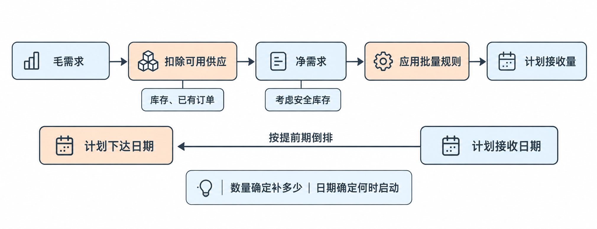
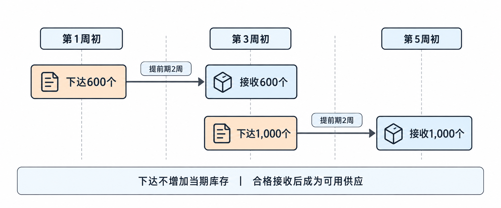
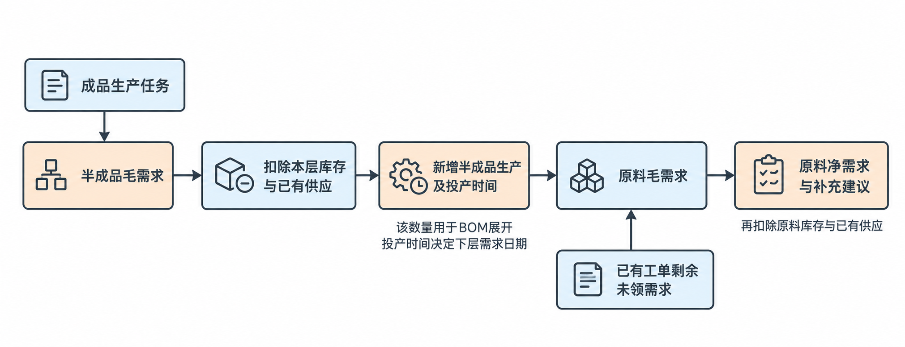
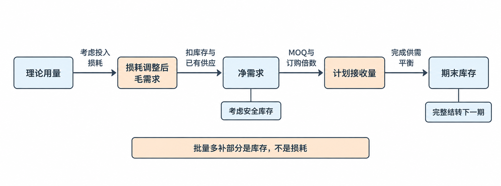
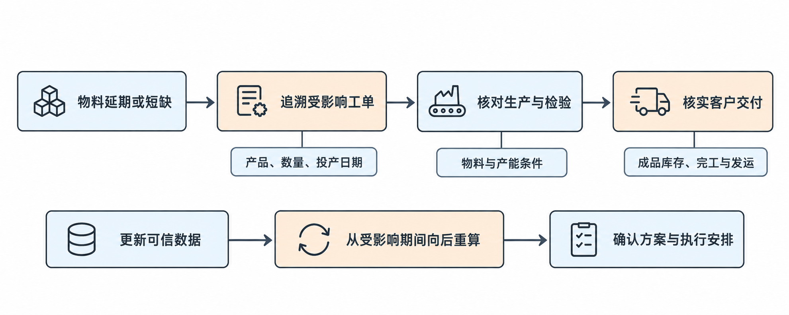
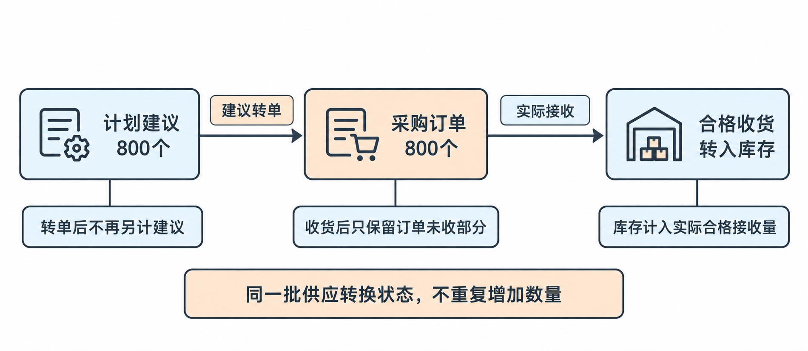

# 第六章 物料需求计划（MRP）

[TOC]

本章学习目标：解释MRP的输入；区分毛需求、净需求、计划接收与计划下达；完成多周期及基础多层BOM运算；判断物料延期、库存不准和需求变化的影响；根据结果提出采购、生产及异常处理建议。最终形成基础MRP运算表和缺料判断，先理解业务逻辑，再使用Excel。各例使用当节列明的数据，学完本章后再集中完成综合练习。已有题目与作答保留在[案例与练习](02-案例与练习.md)中。

## 6.1 MRP的作用与基本计算

第五章主生产计划（Master Production Schedule, MPS）已经回答：哪种产品，要完成多少套，什么时候完成。本节承接经过验证的产品、数量与完成时间，解决支持这些生产任务需要哪些物料、多少数量、何时可用的问题，形成分物料、分时间的补充建议，交给后续采购和生产安排执行，并将无法满足的约束反馈给上游计划。

### 需求来源与计算字段

假设MPS要求第三周末完成WH-A100前门线束1,000套。生产部门仍需知道连接器、端子和电线各需要多少，仓库有多少可用，已采购未到货物料能覆盖多少，剩余部分何时补齐，以及为此何时必须启动采购或生产。

**物料需求计划（Material Requirements Planning, MRP）**的业务作用，就是把产品生产计划转换为分物料、分时间的补充计划。它同时处理数量与时间，只有总数量正确，仍不足以保证生产。

成品计划进入MRP前，需要建立以下衔接：

**成品完工时间 → 倒排生产开始时间 → 确定物料需要时间。**

第三周末完工，不代表连接器可以第三周末才到。如果第三周初就要投产，而且连接器开工时就要使用，那么连接器必须在第三周初投产前成为合格可用物料。实际企业有些物料在后续工序才使用，需要按工序确定需求日期；本节统一假设连接器在开工时投入。

| 输入 | 提供的信息 | 缺少或错误时的影响 |
|---|---|---|
| MPS | 产品、计划数量、完成时间，以及已有工单与新增计划的构成 | 不清楚要支持什么生产任务 |
| 物料清单（Bill of Materials, BOM） | 产品由哪些物料组成，每套用多少，使用哪个版本 | 物料种类或需求数量算错 |
| 库存记录 | 物料数量、地点、质量状态、预留情况 | 将不能使用的库存当作供应 |
| 已有采购订单、生产工单 | 尚未完成的供应数量及预计可用时间 | 重复补充，或高估已有供应 |
| 提前期（Lead Time） | 从启动采购或生产到合格可用所需的时间 | 下达太晚，数量够但时间赶不上 |
| 计划规则 | 安全库存、批量、损耗及工作日历等 | 补充数量或日期不符合实际要求 |

成品需求可以来自客户，而连接器需求通常由生产多少套线束推导出来。前者属于独立需求（Independent Demand）；后者属于相关需求（Dependent Demand），也常称“从属需求”。BOM建立了从生产任务推导组件用量的关系。

连接器也可能作为备件直接销售，从而存在独立需求。本章先讨论它作为线束组成物料的情况，不能把“连接器永远只有相关需求”当成通用规则。

MRP的基本处理顺序是：

**展开用量 → 按时间归集需求 → 扣除可用供应 → 按批量确定补充量 → 倒排下达时间。**

| 概念 | 业务含义 |
|---|---|
| 毛需求（Gross Requirements） | 生产任务需要消耗多少物料，尚未扣除库存和已有供应 |
| 预计接收量（Scheduled Receipts） | 已有采购订单或生产工单预计带来的可用供应，也常称“在途到货量”“已排程接收量” |
| 净需求（Net Requirements） | 扣除可用库存、已有供应，并考虑库存保护要求后，仍需补充的数量 |
| 计划接收量（Planned Order Receipts） | 本次建议在哪个时间点补充多少物料；外购物料也常称“计划到货量” |
| 计划下达量（Planned Order Releases） | 为实现计划接收，建议在哪个时间点启动采购或生产，也常称“计划订单下达量” |

净需求体现缺口；计划接收量还要考虑最小起订量、包装倍数等批量规则，两者不一定相等。本节采用按需补充，缺多少就建议补多少。

已有订单预计接收，是原来已经安排的供应；计划接收，是本次运算提出的新增建议。计划建议转成采购订单后，后续运算应识别这笔已有供应，不能再把原建议作为另一笔供应重复相加。

  

### 连接器补充计划

以下全部为BYD汽车线束工厂的教学模拟数据，不代表真实企业政策或经营数据。

当前位于第一周初，生产与物料条件如下：

| 项目 | 条件 |
|---|---|
| 产品 | WH-A100前门线束 |
| MPS | 第三周末完工1,000套 |
| 任务构成 | 已有工单300套＋新增生产计划700套 |
| 投产时间 | 第三周初，全部物料尚未领用 |
| 连接器 | C-01，每套使用1个 |
| 库存 | 当前合格可用200个，第一、二周无其他收发，结转到第三周 |
| 已有采购订单 | 300个，第三周初投产前检验放行可用 |
| 安全库存 | 第三周期末保留100个 |
| 采购提前期 | 按本例周桶倒排为2周，包含到货及检验放行时间 |
| 其他条件 | 无其他需求、预留和损耗；按需补充 |

**第一步，展开连接器毛需求。**

1,000套线束，每套使用1个连接器：

连接器毛需求＝1,000×1＝1,000个。

这里用的是全部1,000套，因为已有工单300套也尚未领料。成品数量的单位是“套”，连接器物料需求的单位是“个”，两者通过BOM单位用量换算，不能混写。

**第二步，计算净需求。**

需要满足生产消耗1,000个，并在生产后保留100个。已能覆盖的供应是结转库存200个和已有采购预计接收300个。

净需求＝max（0，毛需求＋安全库存－期初可用库存－已有预计接收量）。

本例净需求＝max（0，1,000＋100－200－300）＝600个。

这600个包含两层含义：已有供应只能覆盖500个生产用量，还需要500个才能完成生产；另外再补100个，才能保留安全库存。计算中的安全库存是期末希望保留的数量，不是额外生产消耗。

**第三步，确定计划接收量。**

本例按需补充，因此建议第三周初投产前新增接收600个合格可用连接器。

第三周期末预计库存＝200＋300＋600－1,000＝100个。

生产需求和安全库存要求都得到覆盖。这个预计结果以所有供应按时成为合格可用物料为条件，不代表建议已经落实。

**第四步，倒排计划下达时间。**

连接器第三周初需要可用，采购提前期为两周，因此按本例周桶：

**第一周初计划下达600个 → 第三周初计划接收600个。**

这是同一笔补充安排的两个时间节点，数量不能相加成1,200个。

| 时间 | 安排 |
|---|---|
| 第一周初 | 建议启动新增600个连接器的采购 |
| 第三周初投产前 | 库存200个、已有采购300个、新增补充600个均可用 |
| 第三周初 | 投产1,000套线束，投入连接器 |
| 第三周末 | 完成1,000套线束，连接器预计剩余100个 |

“已经有工单”只表示生产任务已经下达，不代表物料已经领用或齐备。本例300套工单尚未领料，因此仍需要300个连接器。

如果系统已经记录这300个组件需求，应保留并纳入本次计算，只对新增700套生产计划展开700个连接器需求。

| 需求来源 | 处理方式 | 连接器需求 |
|---|---|---:|
| 已有工单300套 | 保留系统已有的未领料需求 | 300个 |
| 新增生产计划700套 | 根据BOM展开新增需求 | 700个 |
| 合计 | 汇总参与计算 | 1,000个 |

不能只算新增700个，也不能保留已有300个后再把全部1,000套重新展开，算成1,300个。**同一笔生产任务的未领料需求，只纳入一次。**实际工作中需要核对需求来源、工单号、需求数量、已领数量和剩余未领数量；已经领用过物料时，未领需求与库存口径应配套，不能机械地再次按全部BOM用量计算。

### 采购落实与计划调整

**计划接收不等于供应已经落实。**MRP算出某时点需要补充多少，并不意味着供应商已经接受数量和日期。采购还需落实订单、交期和运输等安排，物控跟踪到货及放行。如果倒排得到的下达日期已经过去，不能仅凭系统生成一条计划就认定风险解决，应评估加急、替代、调整投产或交付等方案。

**物料到厂不等于可用。**本例已有采购300个能够抵扣第三周需求，是因为明确了“投产前检验放行”。如果只是第三周到厂，仍需核实能否赶上用料时间。晚于用料节点的供应，不能凭数量足够就用于覆盖更早的需求。

**基础MRP算平物料，不代表生产能力已经满足。**连接器够用，也可能因为压接设备、总装人员或工位不足而无法按时完工。MPS先验证关键约束，MRP进一步检查详细物料；发现问题后还要反馈调整计划。产能验证在后续章节系统学习。

分析异常时，应先确定生产需要多少、用料节点前能使用多少，再判断生产缺口和库存保护要求。供应减少量不一定全部转化为生产缺口，原计划的库存缓冲可能先被消耗。负的预计余额表示计划需求未被覆盖，不是仓库中真实存在负数物料；若实际只完成一部分生产，还应同时记录未完成任务与实际剩余库存。

在企业资源计划（Enterprise Resource Planning, ERP）系统中，常见做法是计划员运行MRP，系统读取上游MPS、BOM、库存和未完成订单，输出补充、提前、推迟或取消建议。物控、采购和生产计划人员评审后，将建议转成下游采购或生产安排。仓库收发、检验放行及订单进展再更新供应状态，进入下一轮运算。这使PMC能够把物料风险反馈到生产和交付安排。具体审批和自动转换方式因企业而异。

本节建立的关系是：需求来自生产任务，用量来自BOM，缺口取决于可用供应，补充安排必须同时明确数量和时间。下一节在此基础上扩展为多周期运算，处理库存如何逐期结转。

## 6.2 多周期MRP运算与库存结转

上一节已经知道，某个时间需要多少物料，扣除已有供应后，可以计算补充量。实际工厂会同时面对未来几周的生产任务：第三周剩下的连接器可以留到第四周使用，第四周的采购到货又可能支持第五周。

本节解决连续几周都有需求和供应时，每周究竟需要补多少、什么时候下达的问题。输出是一张多周期MRP运算表，后续用于形成采购安排，以及展开多层物料需求。本节需要掌握库存如何结转、如何逐期计算净需求和计划接收，以及如何按提前期倒排计划下达。

### 逐期计算与安全库存

只有第一周使用本次计划起点的可用库存。此后，本周期初预计可用量＝上周期末预计可用余额，不能每周都重新加一次最初的200个库存。

**预计可用余额（Projected Available Balance, PAB）**表示按照当前需求和供应安排，预计该周期结束时剩余多少物料。它会包含未来计划供应，因此是条件成立时的预计结果，需要持续核实。

每周按照相同顺序计算。

**先看不新增补充时，还剩多少：**

补充前预计余额＝期初预计可用量＋已有订单预计接收量－毛需求。

**然后比较它与安全库存目标：**

净需求＝max（0，安全库存－补充前预计余额）。

- 补充前余额足够保留安全库存：本周不需要新增补充。
- 补充前余额为正但低于安全库存：生产用料可能够，但库存保护不足。
- 补充前余额为负：部分生产用料没有被覆盖，还需要同时考虑安全库存。

确定净需求后，再应用批量规则。本节仍采用按需补充，因此计划接收量＝净需求。

最后得到本周期末余额：

期末PAB＝期初预计可用量＋已有订单预计接收量＋计划接收量－毛需求。

把这个期末余额完整结转到下一周，再重复计算。前面某周的库存变化，会改变后续周次的计算起点，不能只改发生变化的那一格。

**安全库存是余额目标，不是每周消耗。**假设本周期初已有100个安全库存，生产和到货数量正好相等，那么期末仍有100个。这100个并没有被每周消耗掉，不需要每周额外采购100个。

公式里出现“＋安全库存”，是为了检查生产后是否还能保留目标余额；与此同时，之前保留下来的库存已经包含在期初可用量中。必须将这两部分放在同一个计算口径内，不能将安全库存同时当成可用库存和额外消耗反复计算。

### 五周连接器计划

本例独立计算C-01连接器的五周计划。WH-A100每套使用1个C-01，需求、供应及假设完整列在下方，全部为教学模拟数据，不叠加其他例子的延期或追加量。

| 项目 | 第一周 | 第二周 | 第三周 | 第四周 | 第五周 |
|---|---:|---:|---:|---:|---:|
| WH-A100计划完工量：套 | 0 | 0 | 1,000 | 800 | 1,200 |
| C-01毛需求：个 | 0 | 0 | 1,000 | 800 | 1,200 |
| 已有采购预计接收：个 | 0 | 0 | 300 | 1,000 | 0 |

统一条件：

- 第一周初合格可用库存200个。
- 每周生产均在对应周初投产、周末完工，连接器在投产时投入。
- 所有接收数量均须在对应周初用料前完成检验放行。
- 各周期末安全库存目标均为100个。
- 采购提前期为两周，采用本例周桶倒排。
- 无其他需求、预留和损耗，按需补充。
- 第三周已有工单300套与新增计划700套，对应需求已经去重，毛需求仍为1,000个。

连接器需求归入第三周，是因为第三周初要使用它，而不是仅仅因为线束第三周末完工。若成品生产提前期或物料投入工序发生变化，物料需求所在期间也要相应调整。

第一、二周没有收发，200个库存结转到第三周。**先算第三周：**

第三周补充前预计余额＝200＋300－1,000＝－500个。

这表示不增加供应，就有500个生产用料未覆盖。考虑期末保留100个：

第三周净需求＝100－（－500）＝600个。

按需补充600个后，第三周期末PAB＝200＋300＋600－1,000＝100个。这100个完整结转为第四周期初库存。

**第四周有生产需求，也可能不需要新增采购。**期初100个，已有采购预计接收1,000个，生产消耗800个：

补充前预计余额＝100＋1,000－800＝300个。

300个高于安全库存目标100个，因此净需求＝max（0，100－300）＝0个。第四周虽然有800个毛需求，本次仍不需要新增计划接收，因为原有库存与已有采购已经足够覆盖。

第四周期末PAB为300个，全部结转到第五周。不能只结转100个安全库存，把另外200个忽略。

**第五周先使用结转库存，再计算补充量。**期初300个，没有已有订单预计接收，毛需求1,200个：

补充前预计余额＝300＋0－1,200＝－900个。

净需求＝100－（－900）＝1,000个。

计划接收1,000个后，第五周期末PAB＝300＋1,000－1,200＝100个。第五周需要补充的是1,000个，而不是直接照搬1,200个毛需求。

完整MRP运算表如下，数量单位均为个。

| 项目 | 第一周 | 第二周 | 第三周 | 第四周 | 第五周 |
|---|---:|---:|---:|---:|---:|
| 期初预计可用量 | 200 | 200 | 200 | 100 | 300 |
| 毛需求 | 0 | 0 | 1,000 | 800 | 1,200 |
| 已有订单预计接收量 | 0 | 0 | 300 | 1,000 | 0 |
| 净需求 | 0 | 0 | 600 | 0 | 1,000 |
| 新增计划接收量 | 0 | 0 | 600 | 0 | 1,000 |
| 期末PAB | 200 | 200 | 100 | 300 | 100 |
| 计划下达量 | 600 | 0 | 1,000 | 0 | 0 |

### 下达时间与滚动更新

采购提前期为两周，因此第三周初计划接收600个，对应第一周初计划下达600个；第五周初计划接收1,000个，对应第三周初计划下达1,000个。

| 要实现的供应 | 对应的启动建议 |
|---|---|
| 第三周初计划接收600个 | 第一周初计划下达600个 |
| 第五周初计划接收1,000个 | 第三周初计划下达1,000个 |

计划下达表示启动动作，只有接收成为可用供应时，才增加对应期间的库存。因此，第三周同时存在两种不同业务：接收600个，支持第三周生产；下达1,000个，准备第五周供应。**第三周下达的1,000个不能加入第三周库存，也不能用于填补第三周用料缺口。**

  

本例第四、五周的计划下达量为0，仅表示在目前展示的五周需求范围内，没有需要在这两周启动的新增补充；更远期需求出现后，还需继续向后计算。

逐期平衡比总量平衡更严格。未来五周物料总量足够，不能证明第三周就有料开工，必须按每个用料节点检查可用供应。

即使同在第三周，如果连接器周四才放行，而生产周一就需要，也不能用周汇总表掩盖这个时间缺口。本例明确所有供应在周初用料前可用，才可以按表中顺序计算。

前一周变化会传到后一周。某周多消耗一些物料，结转到下一周的库存就减少，后续补充需求可能增加。需求增加不一定立即触发当周新增补充：当周已有供应和库存可能仍足够，但留给后续期间的余额已经减少。因此，需求变化后要从受影响期间向后重算。

分析延期时，应先确认本周能使用的库存和供应，再区分完成生产的用料缺口与生产后保留安全库存所需的补充量。晚于用料节点的供应不能覆盖更早的需求；为了覆盖生产并恢复目标而计算出的补充量，也不代表供应商已经落实。对应练习、学习者回答及数字解析保留在02-案例与练习.md。

系统运行时，计划员应先更新当前库存、已有订单剩余数量及可用日期，再逐期计算，并比较新旧建议的变化。采购和物控据此核实新增、移期或减量安排，输出经确认的执行安排；执行反馈再次更新下一轮输入。已经转成采购订单的供应应作为已有订单识别，原来尚未执行的旧建议不能再作为另一笔供应重复加入。

本节建立了同一物料沿时间轴的需求、供应与余额关系。后续学习将把这套逐期计算方法应用到不同BOM层级，说明上层补充计划如何进一步形成下层物料需求。

## 6.3 多层BOM展开与逐层净需求

上一节已经解决同一种连接器在连续几周中需要补多少、什么时候补的问题。本节增加多层生产关系：线束工厂除了采购连接器，还要先生产压接半成品，再把半成品投入总装；压接半成品又要消耗端子和电线。

如果仓库已经有一些半成品，还有一些半成品工单正在执行，就不能直接按照全部成品数量，再采购一遍所有端子、电线。本节建立“成品生产安排→半成品需求与补充安排→原材料需求与采购安排”的关系，输出逐层的补充数量及时间，交给采购和生产执行。

本节需要区分产品结构用量与本轮需要新增补充的数量，先计算半成品净需求，再展开其下层物料，并判断端子、电线应该在哪一周可用。

### 逐层计算与用料日期

物料清单（Bill of Materials, BOM）中的父项、子项是相对关系。线束是父项，压接半成品是它的子项；压接半成品又是父项，端子和电线是它的子项。如果BOM写着每件压接半成品使用2个端子，这2个对应的是一件半成品，不能直接理解为一套线束。

多层BOM展开（BOM Explosion）在MRP中，需要结合每一层的库存和已有供应：

**计算上层需求 → 扣除该层可用库存和已有供应 → 确定新增生产量 → 倒排投产时间 → 展开下层需求。**

已经在库的合格半成品，不需要为它重新采购一遍组成材料。已有半成品工单则要进一步区分：材料已全部领用，不再为同一工单重复生成未领料需求；材料尚未领用，仍需把其未领组件需求纳入计算。因此，下层需求不仅可能来自新增计划，也可能来自已有工单的剩余用料需求。

新增生产量应应用该父项的批量规则后确定。本节继续采用按需补充，因此父项计划接收量等于净需求。不能把本节的数量相等关系推广为所有批量政策。

半成品第三周需要完工，不代表端子可以第三周才到。如果半成品第二周初投产，端子在开工时投入，端子就要在第二周初可用。

本节采用“计划下达时即投产、开工时一次投料”的简化规则。在这个规则下：

**新增子项毛需求＝父项计划下达量×BOM单位用量。**

需求日期对应父项计划下达、投产日期。实际企业如果提前下达工单，或某物料在后续工序投入，应按实际投料节点确定需求日期，不能机械照搬工单下达日期。

  

### 半成品与原料的补充计算

本例单独计算一批第三周完工的1,000套WH-A100，不计算其他批次。以下结构和供应均为教学模拟，本节数据可独立用于复算：

| 父项 | 子项 | 每单位父项的用量 |
|---|---|---:|
| WH-A100前门线束 | SA-CRIMP-A100压接半成品 | 2件／套 |
| WH-A100前门线束 | C-01连接器 | 1个／套 |
| SA-CRIMP-A100压接半成品 | TERM-T01端子 | 2个／件 |
| SA-CRIMP-A100压接半成品 | WIRE-025-BK电线 | 1.5米／件 |

本章按当前小节给定的简化BOM计算，不能与其他教学案例的不同用量混用。成品在第三周初投产、第三周末完成，半成品和连接器都要在总装投产前可用。

| 物料 | 期初可用库存 | 已有订单预计接收 | 安全库存 | 补充提前期 |
|---|---:|---|---:|---|
| 压接半成品 | 400件 | 第三周初600件 | 0件 | 生产1周 |
| C-01连接器 | 200个 | 第三周初300个 | 100个 | 采购2周 |
| 端子 | 500个 | 第二周初300个 | 100个 | 采购1周 |
| 电线 | 200米 | 无 | 0米 | 采购1周 |

统一条件：

- 按需补充，不考虑损耗、批量限制及其他需求。
- 所有接收量都在对应周初用料前合格可用。
- 已有600件半成品工单的端子、电线，在本次计划起点前已经全部领用。
- 表中原料库存是这些领用发生后的可用数量。
- 原有成品工单300套与新增计划700套已经去重，共需支持1,000套成品生产。

**第一步，计算半成品毛需求。**每套线束需要2件：

半成品毛需求＝1,000×2＝2,000件。

这些半成品需要在第三周初总装投产前可用。

**第二步，计算新增半成品生产量。**已有400件库存，另有600件工单预计按时完成：

半成品净需求＝2,000＋0－400－600＝1,000件。

因此，新增计划接收为1,000件。生产提前期为一周，第二周初计划下达并投产1,000件，第三周初完成接收1,000件。

第三周初可提供的半成品＝库存400＋已有工单600＋新增生产1,000＝2,000件，刚好支持1,000套线束生产。

**第三步，根据新增半成品生产安排展开原材料。**新增生产1,000件：

端子毛需求＝1,000×2＝2,000个。

电线毛需求＝1,000×1.5＝1,500米。

两者都要在第二周初半成品投产前可用。不能按第三周线束完工时间安排原料到货，否则会错过前面的压接生产。

**第四步，分别计算原材料净需求。**

端子净需求＝2,000＋100－500－300＝1,300个。

电线净需求＝1,500＋0－200－0＝1,300米。

两者采购提前期都是一周，均应第一周初计划下达、第二周初合格可用。

| 物料 | 本轮新增补充量 | 计划下达／投产时间 | 计划接收时间 |
|---|---:|---|---|
| 压接半成品 | 1,000件 | 第二周初 | 第三周初 |
| 端子 | 1,300个 | 第一周初 | 第二周初 |
| 电线 | 1,300米 | 第一周初 | 第二周初 |
| C-01连接器 | 600个 | 第一周初 | 第三周初 |

连接器单独核算：毛需求1,000×1＝1,000个，净需求＝1,000＋100－200－300＝600个；按需补充600个，采购提前期两周，因此第一周初下达、第三周初可用。

这张表把采购、压接生产和线束总装连接起来：原材料先到位，才能生产半成品；半成品按时完成，才能支持总装。连接器与端子虽然都采购于第一周，但需求和接收节点不同，不能只看下达周相同就认定用途相同。

### 结构用量与采购数量

单看产品结构，1,000套×2件／套×2个／件＝4,000个端子。这个数表示这批成品对应的理论结构用量，不能直接作为本轮新增端子需求，更不能直接作为采购量，因为2,000件半成品的供应构成不同。

| 半成品来源 | 数量 | 对应端子的处理 |
|---|---:|---|
| 已有半成品库存 | 400件 | 已经包含端子，不再重新备料 |
| 已有半成品工单 | 600件 | 本例端子已全部领用，不重复生成需求 |
| 新增半成品生产 | 1,000件 | 本次需准备2,000个端子 |

因此，本例端子理论结构用量是4,000个，本轮尚需准备的端子毛需求是2,000个，扣除端子库存、已有供应并考虑安全库存后，新增采购建议是1,300个。**这三个数字回答不同问题，不能互相替代。**

如果半成品库存变化，应先重新计算半成品新增生产量，再推导下层原材料需求，不能只修改原材料净需求的某个数字。已有工单的领料状态变化时，则应核实剩余组件需求，在正确期间纳入，并保持库存状态与领料口径一致。

已有工单是否领料，直接影响下层需求。本例600件工单不再增加端子需求，是因为明确了已全部领用；如果未领，就必须纳入其剩余组件需求。每张工单只纳入尚未领用的组件需求，并核对这些领料是否已经从库存中扣除。

同一物料有多个需求来源时，应先按期间汇总，再计算净需求。例如，同一端子同时用于两个半成品，不能让两条需求分别扣除同一份库存。库存只能使用一次。

上层供应异常会向下传递。如果已有半成品延期，需要重新判断能否新增生产；新增生产又会带来原材料、时间和产能要求。不能只改半成品接收数量，就认定问题已经解决。

在系统中，工程维护BOM及版本，仓库和生产反馈库存、领料与完工状态；计划员运行MRP，系统逐层计算并汇总组件需求，输出半成品生产建议和原材料采购建议。采购、生产和物控确认数量、时间及执行条件后，再形成实际安排。计算本身不代表供应和产能已经落实。

本节将各层净额计算与投料时间连接起来。后续需要取消前面“没有损耗、按需补充”的简化条件，判断损耗和批量规则如何改变物料投入、计划接收及后续库存。

## 6.4 批量规则与损耗对MRP的影响

前面已经建立“成品计划→半成品补充→原材料需求→采购数量与时间”的关系，但采用了生产没有损耗、缺多少就能采购或生产多少这两个简化条件。实际压接会消耗端子，供应商也可能要求整包装订购，因此算出的净需求未必能直接作为下单数量。

本节解决为满足生产应准备多少投入、扣除已有供应后实际应补充多少，以及多补部分如何影响下一周的问题。输出是考虑损耗和批量后的采购建议及预计库存，继续交给采购、物控和生产核实执行条件。

### 损耗与批量的计算方法

| 数量 | 回答的问题 |
|---|---|
| 理论用量 | 按BOM，合格产品本身需要多少物料？ |
| 损耗调整后毛需求 | 考虑正常损耗，本轮生产预计需要投入多少？ |
| 净需求 | 扣除可用库存、已有供应，并考虑安全库存后，还缺多少？ |
| 计划接收量 | 应用采购或生产批量规则后，本次建议补多少？ |

本节的顺序是：

**理论用量 → 调整损耗 → 计算净需求 → 应用批量规则 → 计算期末余额 → 结转下一期。**

损耗改变生产预计消耗的数量；批量规则改变补充数量。两者作用不同，不能将批量造成的多采购量当成损耗，也不能将理论用量直接当作采购量。

  

本例端子损耗率（Scrap Rate）为2%，明确指损耗占投入量的比例。这意味着平均投入100个，预计98个形成有效用量。要得到规定的有效用量，应反推：

**计划投入量＝理论用量÷（1－损耗率）。**

如果企业定义的是在理论用量上追加2%，才使用理论用量×（1＋2%）。两种定义不同，不能只看字段都叫损耗率，就套用同一个公式。

本例只对端子使用环节的压接损耗进行调整，不再把同一损耗重复计入半成品数量。实际分析应核实损耗发生在哪种物料、哪个工序，以及是否已经在其他层级或参数中计入，避免重复放大需求。

损耗应作用于本轮需要投入生产的全部理论消耗，再扣除可用库存和已有供应，而不是只放大新增采购缺口。原有库存与已有采购投入生产时，同样会发生压接损耗。安全库存没有投入本轮生产，不跟着这次生产用量一起放大损耗。

前面的按需补充，即逐批法（Lot-for-Lot, L4L），使计划接收量等于净需求。现在加入供应约束：

| 规则 | 业务含义 |
|---|---|
| 最小起订量（Minimum Order Quantity, MOQ） | 有需要下单时，每单不能低于规定数量 |
| 订购倍数 | 订单数量必须是规定数量的整数倍 |
| 固定批量 | 按预设的完整批次组织，可能需要多个批次 |

本节使用MOQ与订购倍数。净需求大于0时：

计划接收量＝向上取整〔max（净需求，MOQ）÷订购倍数〕×订购倍数。

净需求为0时，不会因为存在MOQ就强行下单。固定批量的分批方式、MOQ适用于整张订单还是每次交货，都需要确认企业和供应商的具体规则，不能把这些字段视为完全相同的限制。

### 两期端子采购计算

本例单独计算两期TERM-T01端子的投入与采购，全部为教学模拟数据。第二周计划新生产半成品1,000件，第三周计划新生产1,600件；每件使用2个端子。另有600件已有半成品工单在计划起点前已全部领料，其物料已从下表库存中扣除，不再重复展开。

| 项目 | 条件 |
|---|---|
| 端子 | TERM-T01，每件半成品使用2个 |
| 端子期初可用库存 | 500个 |
| 已有采购预计接收 | 300个，第二周初投料前合格可用 |
| 安全库存 | 100个 |
| 采购提前期 | 一周，按本例周桶倒排 |
| 投入损耗率 | 2%，损耗占投入量，仅调整端子消耗 |
| MOQ | 1,500个 |
| 订购倍数 | 500个 |

**第一步，调整生产投入需求。**

理论用量＝1,000×2＝2,000个。

考虑投入损耗，2,000÷0.98≈2,040.816个。端子以完整的个为单位，保留中间精度后向上取整，损耗调整后毛需求为2,041个。这是按本例损耗参数得到的预计投入，不是保证实际损耗一定恰好为41个。

**第二步，计算净需求。**

净需求＝2,041＋100－500－300＝1,341个。

这里先调整的是全部生产消耗，再扣除已有供应。不能先算出无损耗时的缺口1,300个，再只对这1,300个放大损耗。

**第三步，应用批量规则。**

净需求1,341个，小于MOQ的1,500个；1,500个又满足500个的订购倍数，因此计划接收量为1,500个。采购提前期一周，对应第一周初计划下达1,500个，第二周初投料前合格可用。

**第四步，计算预计库存。**

期末PAB＝500＋300＋1,500－2,041＝259个。

这259个包括安全库存目标100个，以及批量超出净需求的部分159个，即1,500－1,341＝159个。159个会完整进入下一周期初库存。

> 批量多采购的部分仍是库存，不能计作生产损耗。

再算第三周的1,600件半成品。这批用于第四周800套线束，每套需2件，800×2＝1,600件。假设半成品没有剩余库存及其他供应，生产提前期一周，因此第三周初投产、第四周初完成；第二周的1,000件已用于其他已确定任务，不再抵扣本批需求。

第三周端子理论用量＝1,600×2＝3,200个。

仍按2%投入损耗，损耗调整后毛需求＝向上取整（3,200÷0.98）＝3,266个。

第三周期初承接259个库存，没有已有订单接收：

净需求＝3,266＋100－259＝3,107个。

按MOQ和500个订购倍数，计划接收为3,500个，第二周初计划下达、第三周初投料前可用。

期末PAB＝259＋3,500－3,266＝493个。

两周汇总如下，端子数量单位均为个：

| 项目 | 第二周 | 第三周 |
|---|---:|---:|
| 半成品投产量，件 | 1,000 | 1,600 |
| 端子理论用量 | 2,000 | 3,200 |
| 损耗调整后毛需求 | 2,041 | 3,266 |
| 期初预计可用量 | 500 | 259 |
| 已有订单预计接收量 | 300 | 0 |
| 净需求 | 1,341 | 3,107 |
| 计划接收量 | 1,500 | 3,500 |
| 期末PAB | 259 | 493 |
| 对应计划下达时间 | 第一周初 | 第二周初 |

期末库存应完整转入下一期。批量调整后，期末余额可能高于安全库存，这些多出的库存仍可覆盖后续需求。不能每周独立按MOQ采购，而忽略上一周已经剩下的物料。

### 参数维护与异常处理

上层生产批量也会影响下层需求。如果半成品净需求1,000件，但生产批量要求实际安排1,200件，下层端子就要按这1,200件展开，再考虑损耗，不能继续按1,000件准备。

多买不一定等于浪费，但需要解释去向。应核对后续需求、物料通用性、版本适用性和库存占用。批量越大，采购或换型次数可能减少，同时库存和需求取消风险可能增加。

损耗上升不能只靠调高参数处理。需要核对领料、退料、报废、工艺、设备和质量数据，判断是正常水平改变还是临时异常。临时异常应有补料和改善安排，不能未经分析就长期放大采购。实际消耗与计划假设不同时，应按最新库存、未完成需求和供应安排滚动重算。

系统中，工程、工艺和质量提供损耗口径及依据，采购确认MOQ和包装规则，PMC检查计划影响。系统据此计算毛需求、净需求、计划接收及预计余额；采购和生产再确认执行。实际领用、退料、报废和收货反馈，会更新下一轮计划。

计算时先调整生产消耗，再扣除库存与已有供应，最后按批量规则确定补充量。补充后的剩余物料完整转入下一期，供下一次净需求计算使用。

## 6.5 MRP异常与滚动调整

前面已经能够根据生产安排、BOM、库存、已有供应、损耗和批量规则，计算物料补充数量与时间。但计划运行后，供应商延期、客户调整需求、仓库发现库存差异，都可能使原来的安排无法执行。

本节说明条件变化后，如何更新计算、判断受影响的生产任务，并选择可以落实的处理办法。处理结果会进入采购订单、生产安排和后续MRP计算；下一节再把这些内容整合成完整运算与执行流程。

### 异常来源与滚动重算

MRP结果依赖输入。出现异常时，首先要区分业务条件真实变化与原有记录错误。

| 变化来源 | 应核对的数据 | 主要核实人员 |
|---|---|---|
| 需求变化 | 产品、版本、数量、用料时间，以及对应MPS是否调整 | 需求管理、生产计划 |
| 供应变化 | 采购或工单剩余数量、预计完成时间、检验后可用时间 | 采购、生产、质量 |
| 库存变化 | 实物数量、收发记录、待检、冻结及预留状态 | 仓库、质量、物控 |
| 基础数据变化 | BOM用量与版本、损耗、提前期、批量参数 | 工程、工艺、采购及主数据人员 |

客户订单增加，不一定意味着物料需求按相同数量增加。还要看新增订单是否抵扣原预测，以及是否改变成品生产安排。物料需求应依据确认后的生产任务展开。

供应商确认延期，应及时更新可信的预计可用日期，并保留原承诺日期，方便识别延期责任和影响。不能因为变更审批尚未完成，就继续把已经无法兑现的日期当作正常供应。

库存账实不符时，应核对盘点和收发记录；已经确认无法使用的物料，也不能继续计入可用库存。账务调整按企业规定处理，不能为了让计划算平而随意修改数量。

滚动调整就是随着时间推进，以最新实际状态重新安排未来：

- 已经完成的收货、发料和生产，反映在实际库存及完成记录中。
- 已有订单只保留尚未完成的数量，避免重复计算。
- 更新未来需求、供应和适用参数，从受影响期间向后重算。
- 随计划窗口向前移动，补入更远期需求。

计算起点应使用当前实际可用库存，不能一直沿用上一次计划中的预计余额。

### 计算差异与供应调整

重算后，先判断数量是否足够，以及供应能否赶上用料时间。

| 计算结果 | 可能需要的处理 |
|---|---|
| 用料前供应不足 | 增加采购或生产，或寻找其他可用供应 |
| 已有供应数量足够，但到得太晚 | 提前已有订单、加急运输，或调整生产时间 |
| 供应早于实际需要 | 评估推迟接收，减少提前库存 |
| 需求减少，未来供应过多 | 评估减量、取消、延期或转用于其他有效需求 |
| 正常提前期已经赶不上 | 单独处理异常，核实加急、调拨、替代或生产调整方案 |

这些是处理建议。已有订单能否改期或取消，还取决于供应商生产进度、合同条件、费用、版本适用性及企业权限。

需求减少后不能直接取消全部多余供应。物料可能还要支持其他产品，或保留必要库存；供应商可能已经投入生产，取消也未必是成本最低的方案。

还要追踪物料对应哪些任务。需求追溯（Pegging，也常称供需追溯）用于把某种物料需求连接到半成品工单、成品生产任务等来源。这样才能把连接器缺少多少个，进一步说明为哪些线束任务、多少数量、哪个投产日期受到影响。是否进一步造成客户延期，还要检查成品库存、生产检验及发运节点。

  

### 两周连接器计划中的延期处理

下面是一份独立的教学模拟计划，所需条件全部列在这里，不继承其他小节案例或练习的变化。

当前在第一周初，工厂为WH-A100前门线束准备连接器C-01：

- 每套线束使用1个连接器。
- 第二周初投产600套，第三周初投产400套，连接器开工时投入。
- 当前合格可用库存300个，第一周没有收发。
- 已有采购订单PO-01：400个，原定第二周初投料前合格可用。
- 已有采购订单PO-02：400个，原定第三周初投料前合格可用。
- 各周期末安全库存100个。
- 按需补充，无损耗、其他需求和预留。
- 新采购正常提前期为两周。

原计划第二周期末余额＝300＋400－600＝100个；第三周期末余额＝100＋400－400＝100个，不需要新增采购。

现在采购确认，PO-01的400个延期到第三周初才能合格可用。按原需求时间、不增加补救供应计算：

| 周次 | 毛需求 | 原接收量 | 原期末余额 | 延期后接收量 | 延期后预计余额 |
|---|---:|---:|---:|---:|---:|
| 第二周 | 600 | 400 | 100 | 0 | －300 |
| 第三周 | 400 | 400 | 100 | 800 | 100 |

单位均为个。第二周只有300个可用，生产需要600个，因此有300个生产用料未覆盖。如果还要保留100个安全库存，就需要在第二周投料前额外取得600＋100－300＝400个。

表中的－300不是仓库实际存在负库存，而是原计划需求有300个没有得到覆盖。第三周预计余额重新回到100个，只说明后续物料总量能够覆盖这些需求，不能证明第二周按时投产，也不能证明延期任务已经补产完成。补产还需要检查生产能力和后续安排。

不能只在系统中新增一条第二周接收400个的建议就结束处理。正常新采购提前期为两周，而当前已经是第一周初，按正常周期启动的新订单赶不上第二周初。

采购和物控需要比较可兑现的办法：

| 方案 | 必须确认的条件 | 主要代价或影响 |
|---|---|---|
| 催PO-01恢复原交期 | 供应商生产、运输及检验能否赶上 | 加急费用、供应商排产调整 |
| 提前PO-02 | 该批能否提前成为合格可用物料 | 改期费用、其他供应安排变化 |
| 调拨或使用替代料 | 确有可调库存，或替代关系已获批准 | 运输、协调及适用性要求 |
| 调整生产顺序或分批安排 | 其他任务有料，调整后的能力与日期可行 | 原任务延期、换型及客户协调 |

在本案例中，假设经采购核实，PO-02的400个可以提前到第二周初合格可用，运输、检验和相关费用均已确认，变更也按权限通过。调整后的安排如下：

| 订单 | 更新后的可用时间 |
|---|---|
| PO-02，400个 | 第二周初 |
| PO-01，400个 | 第三周初 |

重新计算，两周期末余额都恢复为100个。PO-02移入第二周，就要从第三周原接收量中扣除，同一笔供应不能两周都保留。

如果选择紧急另购400个，又完整保留延期后的两笔原订单，那么第三周期末余额会变为100＋800－400＝500个，比安全库存目标多400个。紧急采购可能解决眼前问题，但还需要核实后续需求，并评估原订单能否推迟或减量，避免形成新的积压。

### 重算频率与执行记录

常见做法是把定期重算与重大事件触发重算结合使用，但不同企业会根据需求波动、数据更新速度和系统能力采取不同安排。定期重算用于更新日常库存、订单进展和未来需求；关键物料延期、重大插单、库存差异或工程变更，则可能需要立即评估受影响部分，不必等到下一次例行计算。

需要保留前后版本，至少能够说明：

- 哪条需求或供应发生变化，依据是什么。
- 哪个物料、工单和生产日期受影响。
- 建议采取什么措施，数量与日期如何变化。
- 谁负责确认，何时答复，是否已经落实。

近期冻结任务、固定计划订单或已下达订单，可能受更严格的修改控制。系统可以保留原安排并提示异常，不一定自动修改所有订单。事实数据要及时更新，执行变更则要遵循相应权限。

在企业资源计划（Enterprise Resource Planning, ERP）系统中，计划员使用更新后的MPS、BOM、库存和未完成订单运行MRP；采购核实供应商交期，生产计划人员核实工单安排，仓库和质量提供实际可用状态。系统输出补充或改期建议，经确认后更新采购、生产安排；收货、领料和完工反馈再进入后续计算。

处理异常需要确认三件事：原因来自最新业务事实且数据口径正确；方案的数量和时间可行，费用及影响已评估；订单、生产计划与责任人的执行记录已经同步。下一节将正常运算、异常调整和执行记录整合到一版完整MRP工作表中。

## 6.6 完整MRP运算与执行衔接

上一节已经知道，发生延期等异常时，需要更新数据、重算影响，再选择能够落实的处理办法。本节把前面的方法组织起来，说明计划员拿到一批生产任务后，应该准备哪些数据、按什么顺序计算，以及怎样把结果交给采购和生产执行。

需要分清三类信息：计划依据说明为什么需要这些物料、计算采用什么数据；运算结果说明还需要补多少、何时接收和启动；执行记录说明建议是否转成订单、日期是否确认、物料是否已经可用。

### MRP工作表的组织与数据口径

实际工作中，可以把相关信息分成三个相互关联的部分。放进Excel时，也可以按这三部分组织工作表。

| 部分 | 主要内容 | 业务用途 |
|---|---|---|
| 计划依据 | MPS、BOM及版本，库存快照，未完成订单，损耗、批量和提前期 | 确认计算基础，方便追查差异 |
| MRP运算明细 | 物料、期间、毛需求、已有供应、净需求、计划接收、计划下达、预计余额 | 确定补充数量与时间 |
| 执行跟踪 | 建议号、正式订单号、责任人、确认日期、实际接收及异常 | 跟踪建议有没有落实 |

首先确定本次计算的时点、需求版本和库存范围。库存、订单剩余数量与领料状态应采用一致口径。例如，工单已经领走的端子，如果已经从仓库可用库存扣除，后续就应保留它的剩余未领需求，不能再次按整张工单生成一遍需求。

计算时，先处理上层物料的补充安排，再据此形成下层需求；同一种物料有多个需求来源时，按期间汇总后再计算净需求，避免不同任务重复使用同一份库存。

### WH-A100完整物料计划

以下是一份独立的教学模拟案例，不继承其他小节订单的变化，所有必需条件均列在本节。

当前为第一周初，已经确认需要第四周初投产WH-A100前门线束500套，第四周末完工。成品数量已经过MPS处理，本例直接承接这500套生产任务。

简化BOM如下：

| 父项 | 子项 | 单位用量 |
|---|---|---:|
| WH-A100 | SA-CRIMP-A100压接半成品 | 2件／套 |
| WH-A100 | C-01连接器 | 1个／套 |
| 压接半成品 | TERM-T01端子 | 2个／件 |
| 压接半成品 | WIRE-025-BK电线 | 1.5米／件 |

物料条件如下：

| 物料 | 期初可用库存 | 已有订单预计接收 | 安全库存 | 提前期 | 补充规则 |
|---|---:|---|---:|---|---|
| 半成品 | 200件 | 第四周初300件 | 0件 | 生产1周 | 按需补充 |
| 端子 | 100个 | 第三周初200个 | 50个 | 采购2周 | MOQ500个，倍数100个 |
| 电线 | 150米 | 无 | 0米 | 采购1周 | MOQ100米，倍数50米 |
| 连接器 | 100个 | 第四周初200个 | 50个 | 采购2周 | MOQ200个，倍数100个 |

另外明确：

- 已有300件半成品工单已全部齐套领料，其端子、电线已经从表中库存扣除。
- 端子压接损耗为投入量的2%，其他物料不考虑损耗。
- 没有其他需求、预留和收发。
- 所有接收量均须在对应周初投料前合格可用。
- 本例下达生产计划时即投产，物料在开工时投入，日期按周桶倒排。
- 本例先完成物料测算，生产能力另行验证。

先确定半成品补充安排。第四周初半成品毛需求＝500×2＝1,000件。已有库存200件、已有工单300件，因此新增半成品＝1,000－200－300＝500件。

生产提前期一周，安排第三周初投产500件、第四周初接收500件。这一步确定以后，才知道本轮新增压接生产需要准备多少端子和电线。

端子理论用量＝500×2＝1,000个。考虑2%投入损耗，端子毛需求＝向上取整（1,000÷0.98）＝1,021个。

端子净需求＝1,021＋50－100－200＝771个。

按MOQ500个、100个订购倍数，计划接收800个。期末预计余额＝100＋200＋800－1,021＝79个。

端子要在第三周初半成品投产前可用，采购提前期两周，因此第一周初就需要启动。

电线毛需求为500×1.5＝750米，扣除库存150米，净需求600米，符合批量规则，计划接收600米。

连接器直接用于第四周线束总装，净需求＝500＋50－100－200＝250个。按100个订购倍数，计划接收300个。

完整结果如下，数量按各物料基本单位计算：

| 物料 | 毛需求 | 净需求 | 新增计划接收 | 计划接收时间 | 计划下达时间 | 期末预计余额 |
|---|---:|---:|---:|---|---|---:|
| 半成品，件 | 1,000 | 500 | 500 | 第四周初 | 第三周初 | 0 |
| 端子，个 | 1,021 | 771 | 800 | 第三周初 | 第一周初 | 79 |
| 电线，米 | 750 | 600 | 600 | 第三周初 | 第二周初 | 0 |
| 连接器，个 | 500 | 250 | 300 | 第四周初 | 第二周初 | 100 |

这张表同时说明数量和时间：端子、电线支持第三周的压接生产；半成品、连接器支持第四周的线束总装。各种物料的补充数量受库存、已有供应、损耗和批量分别影响。

### 采购与生产的执行跟踪

得到上表后，不能立即认定生产条件全部满足。预计余额已经计入新增计划供应，而这些供应仍需要落实。

执行跟踪可以这样记录：

| 建议编号 | 建议内容 | 主要责任人 | 初始状态 |
|---|---|---|---|
| PL-T01 | 采购端子800个，第三周初可用 | 采购 | 待评审、确认供应 |
| PL-W01 | 采购电线600米，第三周初可用 | 采购 | 待评审 |
| PL-C01 | 采购连接器300个，第四周初可用 | 采购 | 待评审 |
| PL-SA01 | 生产半成品500件，第三周初投产 | 生产计划 | 待核实物料与能力 |

当前已经是第一周初，端子建议的下达节点就在本期，因此需要优先确认供应商是否能够承接、运输检验能否按期完成。电线和连接器虽然计划第二周启动，也要按各自节点跟踪。

常见状态可以区分为：

- 待评审：计算建议尚未获得执行确认。
- 已下达：已经形成正式采购订单或工单。
- 日期已确认：供应商或生产部门确认了相应数量及时间。
- 合格可用：实际完成接收、检验放行，可以投入生产。

这些状态不能相互替代。采购订单已下达，仍需跟踪交期；供应商已确认，仍可能出现执行偏差；到厂后也要按质量状态判断能否使用。

### 建议转单与实际收货的去重

以端子800个为例，假设PL-T01经过评审，已经转成一张新的采购订单，应保留建议号与正式订单号的关联。

下一轮运算中，第三周已有订单预计接收量变为原采购200＋新采购800＝1,000个。原来的800个计划建议不再作为另一笔新增供应叠加。

在其他条件不变时：

新增净需求＝max（0，1,021＋50－100－1,000）＝0。

预计余额仍为100＋1,000－1,021＝79个。

**供应从计划建议转成了已有订单，数量没有凭空增加。**

半成品建议转成正式工单时，也要进行相应处理：组件需求沿工单保留，原计划与工单保持对应关系，不能在已有工单需求之外，再重复展开同一批500件。

实际收货以后，同一批物料还会继续从未完成订单供应转为库存。部分收货时，库存增加实际合格接收量，订单仍保留未完成部分；不能把整张订单和已收到的物料重复计入供应。

  

### 运算结果的复核与实际反馈

复核完整MRP时，至少要检查以下内容：

| 检查内容 | 要确认的业务事实 |
|---|---|
| 需求来源 | 对应哪项生产任务，产品和版本是否正确 |
| 数量计算 | 库存、已有供应、损耗和批量是否处理正确，有没有重复 |
| 用料时间 | 供应是否在实际投料前合格可用，提前期是否来得及 |
| 执行落实 | 建议是否转单，数量与日期由谁确认，未落实部分是什么 |
| 生产与交付 | 工序能力、完工检验和发运安排是否支持所需日期 |

如果供应商只确认部分数量，应分别记录已确认数量和剩余风险，不能把整笔计划量都标为落实。出现延期、短交或质量冻结时，再按6.5的方法更新数据、追踪受影响任务并处理。

在ERP中，工程提供BOM及版本，计划人员提供MPS和计划参数，采购、生产、仓库及质量提供订单进展与实际可用状态。MRP输出建议，责任部门评审并形成正式安排，实际收发与完工记录再更新后续计算。

Excel中的业务逻辑相同。制作运算表时，应保留需求来源、建议号和正式订单号，使每个数量既能找到计算依据，也能找到执行责任人。本节演示完整运算及工作表字段，未创建Excel文件，也没有落实真实采购或生产订单。

本章说明了从MPS取得生产任务，逐层、逐期计算物料需求，确定补充数量和日期，再跟踪订单与实际结果的方法。知识讲解到此完成，整章掌握情况仍需综合练习验证，重点包括多层展开、工单需求去重、损耗与批量、日期倒排及异常处理。
